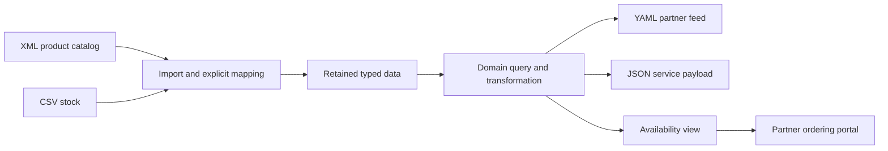

# Declarative Amsterdam 2026: presentation design and adoption plan

Internal ideas and preliminary design plan, revised 2026-10-11. This document
organizes audience priorities, demonstrations, adoption goals, and preparation.
The published conference session sets the delivery commitment; this plan
explains how to make that session persuasive.

## Document ownership and session constraints

| Document | Authority |
| --- | --- |
| [Conference program](https://declarative.amsterdam/program) | Published title, speaker, session description, and conference slot |
| [Proposal and participant resources](https://github.com/EPA-WG/cem/discussions/24) | Proposed subjects, six timeline blocks, and the stable destination for updated resource links |
| [Presentation agenda and minutes](presentation.md) | Current source-aligned agenda, detailed delivery minutes, and coverage of both public sources |
| [CEM platform pitch](cem-platform-pitch.md) | Audience-facing positioning, platform goals, and adoption message |
| [CEM manifesto](cem-manifesto.md) | Principles behind the platform's direction |
| [Platform evidence](platform-evidence.md) | Capability facts, implementation boundaries, sources, and proof gaps |
| This plan | Internal ideas, narrative design, demonstration options, and preparation dependencies |
| [Active work in docs/todo.md](../todo.md#current-work-declarative-amsterdam-2026-cem-presentation) | Sole active execution checklist, including fixtures and verification work |

Use the pitch for audience copy and the presentation minutes for timing. Design
options here must fit the published session, **CEM-ML declarative document
lifecycle engine**, presented by **Sasha Firsov**. Preserve the proposal's six
blocks and the program's practical promises; sales and adoption framing give
those activities purpose rather than replace them.

The **60-minute slot** starts at **13:45 CET on Thursday, 12 November 2026**.
Assume no previous CEM-ML experience. Explain terms when needed, invite small
participant decisions, and make the presenter-led route sufficient without a
working local setup. Keep questions and recovery within the slot. Verified
conference facts and correspondence limits belong in the
[presentation agenda](presentation.md).

## Audience priorities and adoption outcome

The strongest initial audience owns structured data and must process it for
several consumers, delivery channels, or partner integrations. The conference
entry point should respect XML expertise while making the wider market clear.

| Priority / audience | Familiar starting point | Decision the presentation should enable | Evidence to prioritize |
| --- | --- | --- | --- |
| Primary: XML/XSLT developers | XML, XPath, XSLT, publishing pipelines | Whether CEM extends existing expertise into other formats and delivery paths | XML/CEM-ML and supported XPath/CEM-QL comparisons, followed by useful outputs |
| Primary adjacent: data and automation engineers | Feeds, conversion, batch jobs, validation, CI | Whether one processing definition can replace repeated rules | Core document conversion and CLI path; multi-source/output companion example |
| Service and tooling developers | Backends, import/export, editors, domain services | Whether the engine fits behind an existing product interface | Platform overview and a linked library example returning artifacts and diagnostics |
| Secondary conference, strong online: web UI developers | HTML, components, binding, build tools, SSR | Whether processing and interaction can be reused across hosts | Standalone and embedded views, explicit state and customization |
| Platform and integration engineers | Schemas, APIs, onboarding, access controls, budgets | Whether change and authority boundaries are inspectable | Contracts in the core journey; verified connector and denied-access companion examples |
| Product and partner owners | Distribution, delivery cost, customer workflows | Whether a bounded integration deserves investment | Measured repeated work and a capability used inside a partner workflow |

The desired exit action is one bounded pilot: a difficult format boundary,
repeated processing rule, service integration, or capability a partner needs
to embed. A platform replacement decision follows evidence from that pilot.

## Message hierarchy and editorial choices

Open with the brief thought → DNA → CEM metaphor, introduce the session, then
show the working login view and the market goals from the public pitch.
Use that result to explain why a document lifecycle matters across data services,
pipelines, and applications. Each promised activity should answer a practical
question: can I read it, change it, trust it, diagnose it, convert it, and make
it useful? Embedding supplies a commercial destination while CLI and library
use retain independent value.

| Message level | Attraction point | Presentation treatment |
| --- | --- | --- |
| Lead | Neutrality to formats, source locations, and execution tiers | Familiar source comparison and second format for the same model; multi-source/output companion |
| Lead | Processing reusable through CLI, library, and browser hosts | Follow the document into a web view; identify supported runtime entry points in the platform overview |
| Lead | Security insulation around independently supplied scopes | Brief six-layer scope explanation in the platform overview; deeper verified proofs as companions |
| Lead | Embeddable capability and traceable results | Diagnose the document failure, then show its working light-DOM view |
| Explain | Evolutionary Architecture | Dedicated explanation in the opening seven minutes, followed by recurring contract evidence |
| Companion | Connectors, version adapters, state continuity, SSR/resume | Independent examples for the website or questions, subject to verified time |
| Support | Native/WASM portability, concurrency, demand loading | Required runtime overview; workload measurements and deeper mechanisms in companion material |
| Catalog | 32 checked-in schema packages and extension mechanisms | Linked catalog; show pick/extend/create choices during validation without a separate catalog tour |
| Direction | Complete vendor containment, full progressive processing, bundler parity | Explicitly identified goals with proof requirements |

Use each feature to answer a practical question before naming its mechanism.
Avoid a package inventory or notation tour as the organizing structure.
Use the [code preview workflow](code-preview.md) for CLI tabular source and
CEM-colored HTML/screenshots; its first login preview is ready for visual review.
The AI-era argument is a strategic thesis about connecting more available
software to existing workflows. Do not use an unsupported tenfold app-growth
claim or imply that AI-generated declarations are safe by construction.

### Writing style for the presentation

Use the user's concise style throughout the pitch, slides, website, and spoken
copy. Keep it direct and easy to scan.

- Lead with the benefit or action. Use concrete words and active verbs.
- Keep sentences focused and paragraphs short. Connect each sentence to the
  previous one so the argument develops naturally.
- Cut repetition and abstract lead-ins. Keep details that change the meaning.
- Use lists for parallel choices and tables for comparisons.
- Keep capability limits brief and precise; link supporting evidence.

Preferred example: “Adopt pretty and tabular formatters, color output in HTML
and terminals.” The [pitch](cem-platform-pitch.md) is the style reference.

When describing schema choices, retain all three: “Pick, extend, or create
your own schemas.”

## Agenda boundaries and rehearsal priorities

Use [presentation minutes](presentation.md#presentation-minutes) as the single
timed run sheet. It preserves the discussion's six intervals: why the stack
must evolve; reading and editing the login document; validation, inspection,
diagnostics, and conversion; querying and templating into a light-DOM view;
the platform; then participants' use cases and questions. This plan adds no
competing schedule.

The required demonstration follows **one login document** through that journey.
After the opening metaphor and title, show the finished view before returning
to its source. Keep XML/CEM-ML and
XPath/CEM-QL comparisons within the corresponding reading and query blocks.
The platform overview must include Rust native/WASM, CLI, Node, browser and
worker use, `cem-element`, Consumer Semantic Theme, CEM Components, CEM Studio,
and CEM Site. Connect each to the document already demonstrated.

Treat full SDLC coverage, format/location/tier neutrality, extensible
connectors, and security insulation as reasons behind these activities. Their
deeper examples are design options for the website or questions. The supplier
pipeline below supplements the promised login exercise; it does not replace
it. Do not crowd validation, source-linked repair, conversion, or the working
web view out of the session with additional feature tours.

Keep the core path runnable without participant installation. Prepare saved
checkpoints for each required stage and rehearse source/result panes at remote
viewing size. If time slips, omit optional variants and shorten exposition;
preserve the public lifecycle demonstration, platform overview, and audience
questions. Rehearsal decides which companion examples fit, not which published
subjects to drop.

## Development lifecycle proof journey

The audience should see continuity from source selection to operating and
changing software through the required login exercise. Studio is the planned
interactive workbench and is not ready yet; CLI and library interfaces connect
the engine to existing editors, hosts, and automation. The table is a design
coverage map, not ten separate live demonstrations. Reading, editing, validation,
inspection, repair,
conversion, querying, and rendering receive the time promised publicly; the
platform overview and companion material connect them to the remaining stages.
The [lifecycle evidence](platform-evidence.md#development-lifecycle) records
the current foundations for this journey.

| Stage | Presenter action / deliverable | Definition or evidence carried forward |
| --- | --- | --- |
| Choose sources and consumers | Identify formats, locations, outputs, and expected results; select or customize connectors | Source/output identities and resource bindings |
| Pick, extend, or create schemas | Pick an existing package, extend its rules, or create a domain schema | Vocabulary, types, validation rules, and diagnostic behavior |
| Import or develop modules | Reuse a transform; edit one query, mapping, or template | Explicit input/output and dependency contracts |
| Compose | Connect sources, stages, branches, outputs, and optional view; identify scopes | Transformation graph and requested host resources |
| Iterate and debug | Edit, run, inspect an intermediate result, locate and repair a failure | Source-linked diagnostics and a reproducible case |
| Verify | Run expected-output and invalid-input checks; add the selected compatibility and denied-effect cases | Executable evidence protecting named contracts |
| Package | Show versioned definitions, dependencies, and required assets | Identified resources and repeatable build inputs |
| Execute | Invoke the CLI, library host, and browser operation under specified profiles | Shared semantics plus explicit host bindings |
| Operate | Inspect failure, progress, output, and relevant resource use | Runtime evidence tied to editable sources |
| Evolve | Change one source, connector, version, module, or host; rerun its checks | Localized change and an explicit compatibility result |

Security and performance participate throughout: identify requirements during
composition, check enforceable boundaries and workloads, bind host policy at
deployment, then inspect behavior during execution. The service host still
owns endpoints, scheduling, authentication, and operational deployment.

## Required login demonstration and companion examples

### Core: one document through its lifecycle

Use the login document promised in the conference program and proposal. The
same displayed source should connect every stage, with saved checkpoints so a
failure does not prevent the next promised activity.

| Required checkpoint | Visible result | Design purpose |
| --- | --- | --- |
| Read and edit | XML beside CEM-ML; a small change in the login document | Make the notation approachable without a syntax lecture |
| Validate and repair | An intentional schema failure, source-linked diagnostic, and corrected document | Show why picking, extending, or creating schemas matters |
| Inspect | Typed document structure tied to the displayed source | Make the shared model and diagnostic evidence visible |
| Convert | A second representation of the same model | Explain format neutrality and any explicit mapping limits |
| Query and transform | Supported XPath beside CEM-QL, then a template producing the view | Connect existing expertise to reusable processing |
| Render | A working login view through the light-DOM `cem-element` path | Deliver the published practical outcome |
| Locate it in the platform | Trace the example through the named runtimes, theme, components, Studio, and Site | Show where to continue development and adoption |

Verify the selected schema, invalid edit, conversion, query, template, and
rendering path as one reproducible example. Pick the second format only after
confirming that the example's agreed model and required semantics are retained.
Describe the login view's actual behavior; do not imply a production identity
service or security guarantees beyond the demonstrated implementation.

### Companion: supplier data across inputs, outputs, and hosts

Use supplier availability to deepen the broader platform pitch online or in
questions. Product descriptions arrive as XML and stock as CSV. Explicitly
match records by product ID, convert numeric values under a stated rule,
select availability, and branch to a YAML partner feed, a JSON service payload,
and a web view. Graph joins organize artifacts; the domain query owns the
business matching. This proposed extension makes multiple inputs and outputs,
each in its own format, concrete without replacing the promised core.

For this companion, prepare one source set, mapping, domain rule, expected-result
set, and failure case across the selected hosts. The composed example remains
proposed until its fixtures, commands, and outputs are verified; individual
repository operations do not establish the whole demonstration.

| Entry point | Companion demonstration | Host responsibility and boundary |
| --- | --- | --- |
| Linux native CLI | One automated run produces multiple file artifacts and diagnostics | Bind permitted input/output paths and capture the reproducible command |
| Library in a small service or tool | Invoke supported processing, inspect returned artifacts, return the explicit JSON output | Own transport, identity, scheduling, error handling, and publication |
| Node/WASM | Run the selected common engine operation | Declare supported I/O and runtime requirements |
| Browser/WASM | Inspect the result and compose the availability view into a partner portal | Supply task context, resources, theme, and allowed actions |

Use the [CLI/library evidence](platform-evidence.md#cli-library-and-pipeline-applications)
to choose actual entry points. Record the precise engine/runtime versions and
supported profiles. Do not imply that every native operation or connector is
available identically in every host.

## Familiar comparisons and schema breadth

Keep XML and CEM-ML side by side with corresponding names, attributes, values,
and source positions highlighted. Pair supported XPath and CEM-QL expressions
with an equivalent question and comparable output. Explain language differences
where the examples need them; do not imply complete XPath/XSLT conformance.
Existing (X)HTML and bounded XSLT support are bridges to familiar work.
An optional CSS-selector comparison can provide a web-developer entry point
when it asks the same supported question; identify differences in selection
semantics instead of implying language interchangeability.

CSV-to-YAML alone proves conversion. XML + CSV computation with an explicit
join and numeric rule proves more of the neutrality argument. Preserve format
distinctions: types, namespaces, ordering, lexical details, and mixed content
need explicit mappings and loss reporting when relevant.

The [schema catalog](platform-evidence.md#schema-package-catalog) lists all
32 checked-in packages by purpose. Use it as evidence of breadth, with parsing,
validation, query, formatting, and rendering support identified independently.
Show the choice to pick, extend, or create a schema while validating the login
document. A separate vocabulary extension and its diagnostic are companion
options, included live only if rehearsal preserves the required activities.
An arbitrary new lexical syntax also requires a parser/import adapter; a schema
definition alone does not generate universal parser support.

The core diagnosis proof must locate and repair an error in the login document.
For the supplier companion, select an incorrect availability result and trace
it to its stock cell or product node. A generated asset dependency offers
another optional trace. Verify each path before showing it; the point is an
explainable failure, not a promise of universal provenance.

## Variant and proof coverage

Keep these variants as optional coverage beyond the required login journey.
Prepare them as independent website examples or answers to audience questions.
A live variant needs verified timing within the published blocks; it must not
displace a required activity. None is a completion claim until its composed
path is verified.

| Variant | Visible change | Contract / proof | Place in the narrative |
| --- | --- | --- | --- |
| Source format | Change stock CSV to JSON | Same agreed domain output; format mapping changes explicitly | Supplier companion: evolution |
| Schema extension | Add a product constraint and violate it | Useful source-linked rejection, then successful repair | Supplier companion: schema extension |
| Resource location | File → permitted HTTPS → host-supplied memory | Same query/result, updated provenance, retained denial of ungranted locations | Connector proof candidate |
| Publication | Return the result through another supported publication path | Named output semantics and host access policy preserved | Connector extension |
| Version adapter | Supplier v2 field/structure → explicit v1-compatible transformation | Version range and meaning-preserving limits declared; consumer checks still pass | Evolution extension |
| Processing host | CLI → library → selected WASM host | Agreed outputs and diagnostics for the supported profile | Companion runtime comparison |
| Embedding | Standalone view → partner-hosted view | Same capability receives host context and keeps behavior coherent | Companion embedding payoff |
| Host styling | Same view in two themes | Provider-declared tokens/hooks work; incompatible customization is reported | Web-developer extension |
| Presentation context | Compact indicator → detailed panel → dedicated page | Same domain result with deliberate task-specific presentation | Proposed UI variants, not a universal mode API |
| Multiple instances | Two suppliers or product selections on one page | Independent instance context and selection state | Ownership proof |
| Explicit effects | Read-only result → permitted reservation/persistence service | Grant or withhold host service; no ambient authority inferred | Application/security bridge |
| Denied resource | Request an ungranted location or publication | Denial before the identified I/O path; separate permitted work completes | Companion security proof |
| Cross-tier state | Server output → browser continuation → state update | Compatible state/revision/declaration identity; stale revision handled | Lifecycle depth candidate |
| Resource pressure | Constrain or cancel one admitted workload | Measured limit/cancellation behavior and independent sibling result | Performance/security candidate |

Format adapters handle representation. **Extensible, customizable connectors**
handle access and delivery through host resolver/publication interfaces.
Demonstrate these as separate extension boundaries, including a connector for
a team's own source or destination where appropriate. Host-managed storage
does not imply a built-in connector for every database or vendor service.

Provider ownership and independent release schedules matter. The host supplies
the selected product, locale, theme, permitted actions, and admission policy.
Start with a read-only result; add a host service only through a declared effect
boundary. Compatibility failures may require a version adapter, consumer work,
or rejection. They are not automatically repaired by a common runtime.

## Scope security: explain the mechanism and prove the boundary

Introduce the scope model briefly in the 47–54-minute platform overview. The
six-layer diagram connects independent modules to the insulation model; a
complete enforcement tour belongs in companion material or questions. Use the
DCE scope/inclusion model as the architectural explanation: each
independently supplied application, pipeline stage, or connector is surrounded
by applicable insulation layers. Declarations request access, hosts determine
grants, and runtime mechanisms must enforce the boundary during execution.
Memory, Storage, CPU, and Network apply to processing; browser interfaces add
DOM and CSS. Contracts describe and configure insulation; they do not replace it.

The [six-layer evidence matrix](platform-evidence.md#six-resource-layers) is
the capability authority. The table below selects proof candidates from it;
these candidates are not yet verified presentation demonstrations.

| Layer | Repository-backed control to evaluate | Bounded proof candidate | Remaining full-insulation proof |
| --- | --- | --- | --- |
| Memory | Accounted allocations, input/artifact bounds, inherited ceilings | Exceed a known limit and inspect its failure while sibling work completes | Private state/reference isolation and complete per-vendor memory accounting |
| Storage | Host repository ports, narrowed read-only access, export/redaction | Permit an assigned read, withhold mutation, exclude private export fields | Per-vendor namespace/operation authority and quotas on every path |
| CPU | Fixed executors, ancestor permits, child caps, cancellation/deadlines, bounded workers | Constrain/cancel a workload; show deterministic independent output | Preemptive limits for arbitrary code and complete descendant consumption control |
| Network | Host resolvers and pre-access policy decisions | Deny one configured request before resolver I/O; allow another | All egress paths, credentials, redirects, alternate APIs, and revocation |
| DOM, browser | Inert state islands, owned ranges, nested ownership; no live DOM in workers | Update one instance while preserving sibling state/focus | Hostile same-page script and active-markup confinement |
| CSS, browser | Native scoped rules, ownership, hooks, limits, diagnostics | Two host themes and a rejected unsupported construct | All style effects, inheritance, and resource-bearing constructs |

For the companion proof, show a scope/inclusion diagram with a supplier
receiving product and stock data, a shipping contribution receiving only region
and parcel dimensions,
and the view receiving results. Annotate requested and granted resources.
The full multi-vendor composition is a proposed proof; identify exactly which
part of the diagram each live denial establishes.

Nested scopes must retain ancestor safeguards, narrow delegated authority,
and respect aggregate ceilings. Include sibling behavior and descendant work
in relevant negative cases. Revocation, generated output becoming active,
callbacks, and privileged connectors/extensions are separate enforcement paths
to establish. CEM's light DOM and scoped CSS alone do not confine hostile code.

Use three explicit evidence labels during preparation and delivery:
**demonstrated in this build**, **implemented but not covered by this example**,
and **architectural goal**. The independent-vendor benefit stays central while
the proof remains specific about engine, host, profile, and trust assumptions.

## Evolutionary Architecture: one explanation, recurring evidence

Use minutes 0–3 for the DNA metaphor, session title, and finished login view, then
minutes 3–7 to explain Evolutionary Architecture within the proposal's opening
block. The explanation merits its own slide; the
[presentation minutes](presentation.md#presentation-minutes) own the timing.
In the platform block, use the added “Browser vs DCE security” diagram as a
30-second bridge from deployment routes to scope insulation. It contrasts
shared host resources with owned, guarded resources for each vendor, including
nested applications. Carry that security ambition across browser, backend,
and CLI hosts; the evidence record defines the supported operations and
enforcement boundaries. Keep the four interleaved reference
slides optional, with no additional scheduled time.
Connect it to the [authors' account of incremental change and fitness functions](https://evolutionaryarchitecture.com/precis.html).
Repeat three questions with each significant change: what changes, what remains
stable, and which executable check proves it?

| Change dimension | Preserved property | Evidence to prepare |
| --- | --- | --- |
| Syntax or location | Agreed meaning and correct source attribution | Mapping-equivalence cases; resource-binding swap; forbidden source still denied |
| Schema or version | Declared compatibility and rejection behavior | Pinned valid/invalid cases and the explicit v2-to-v1 adapter |
| Query or transform | Named output semantics | Expected-result comparison and relevant transformation lineage |
| Runtime | Operation semantics within advertised host capability | Same input across selected native/Node/browser paths |
| Render/deployment tier | State, revision, declaration identity | Resume/update plus stale-revision behavior |
| Vendor or connector | Public interface and granted authority | Compatibility and denied-action cases for its actual enforcement path |

Tie this to cost of change, security, and performance. A faster implementation
must preserve allowed behavior; a new boundary must still meet the selected
latency and resource requirements. Extensibility alone is insufficient proof
of guided evolution.

## Measurement and transformation-graph coverage

These are companion proof requirements, not an additional block in the
conference agenda. Introduce the relevant execution choices in the platform
overview; keep a detailed benchmark, SSR/resume, concurrency, or streaming
demonstration for the website or questions unless rehearsal proves it fits.

Choose one workload that demonstrates a useful outcome. Keep input, output,
operation, runtime version, machine/browser, and policy profile explicit.
Measure cold and warm behavior separately and include correctness checks.

| Workload concern | Measure | Interpretation boundary |
| --- | --- | --- |
| Interactive delivery | Time to first useful result, main-thread blocking, transfer | Earlier output is distinct from earlier completion |
| Pipeline/service execution | Completion time, throughput, request latency, cost per completed workload | Compare equivalent workloads and include host overhead |
| Resource consumption | Peak memory, accounted allocations, cancellation latency | Accounted engine bytes are not necessarily the whole process heap |
| Concurrency | Worker count, startup, transfer/serialization, sibling progress | More threads or WASM do not guarantee a faster workload |
| Progressive processing | Stage start/output times and buffering | Identify which loading/validation/transformation/formatting/output stages actually overlap |

Retained structures can avoid conversions while materializing a complete
input. Demonstrate actual bounds and backpressure where supported; end-to-end
progressive consumption and arbitrary streaming queries remain separate proof
requirements. Demand loading and SSR/resume need their own observable cases.

The graph's existing use to assemble Studio assets is a packaging example.
For the goal of modern bundler parity, maintain capability evidence for module
resolution, assets, caching, splitting, tree shaking, source maps, development
updates, and plugins. A graph demonstration does not establish all of these.
Use [processing evidence](platform-evidence.md#processing-delivery-and-performance)
to choose the claims and variants that are ready.

## Commercial adoption and pilot acceptance

Use the closing use-case discussion to invite one bounded pilot and let
participants connect the lifecycle to their own work. The detailed acceptance
criteria below support follow-up and the website; do not turn the final
question period into a second sales presentation.

Show who benefits: providers reuse a capability across consumers; hosts reduce
reconstruction and onboarding work; users keep task context and avoid repeated
navigation or data entry. Measure these effects rather than presenting a
guaranteed saving.

| Repeated work | Mechanism under evaluation | Pilot measure |
| --- | --- | --- |
| Data interpretation per consumer | Schemas, explicit mappings, shared queries | Hours and mapping defects per new source/consumer |
| Rules repeated in jobs, services, and tools | CLI/library reuse of processing modules | Rule implementations and effort needed for one change |
| Provider interaction rebuilt by each host | Reusable view, behavior, and extension points | Time to a functioning partner integration |
| Lifecycle/state glue | State identity and explicit resume | State-loss defects and host-specific code changed |
| Failure investigation | Source-linked diagnostics and graph provenance | Time to locate the responsible input or rule |
| Resource-access review | Explicit mediation and verified boundaries | Review hours, granted privileges, demonstrated denials |
| Migration across consumers | Versioned contracts and adapters | Unrelated modules touched per update |

Agree on a baseline implementation and requirements before measuring. The
pilot supports broader adoption when it preserves agreed output, localizes
the selected source change, exposes a failure's source, and reduces measured
integration effort. It must also meet the baseline's accessibility, security,
and performance requirements. A result that exposes a missing capability is
useful evidence for deciding scope; it is not a successful replacement claim.

Estimate economic value from measured engineering hours avoided times loaded
cost, plus operating savings, less adoption and ongoing maintenance. Business
authorization, authentication, semantic mapping, accessibility, and operational
ownership remain explicit integration responsibilities.

## Comparison preparation

Keep these comparisons as preparation for questions and optional website
material. The main session retains its promised document journey. Choose
comparisons relevant to the selected audience question. Acknowledge
existing strengths, then demonstrate the particular CEM combination. These
sources provide context, not implementation requirements for CEM.

| Neighboring solution | Strength to acknowledge | Comparison to prepare |
| --- | --- | --- |
| [Enterprise transformation tools](https://www.ibm.com/support/pages/getting-started-websphere-transformation-extender-design-studio-datapower) | Established transformation/integration, including non-XML and multiple execution modes in relevant products | Changes in format, location, and host using CEM's extension boundaries |
| [Saxon/SaxonJS](https://www.saxonica.com/html/saxonjs/index.html) | Mature XML/JSON, XPath/XSLT, browser/Node and interactive XSLT | Specific supported profiles, lifecycle integration, and application composition |
| [XProc](https://spec.xproc.org/3.0/xproc/) | Declarative pipelines over multiple document types | Connection of retained processing to state, views, and delivery |
| [Invisible XML](https://invisiblexml.org/) | Declarative grammars for bringing other syntax into XML workflows | Schema-package lifecycle and the actual adapter requirements |
| [Module Federation](https://webpack.js.org/concepts/module-federation/) | Independent builds, runtime loading, shared modules | Data, state, and authority contracts alongside delivery |
| [Sandboxed iframes](https://html.spec.whatwg.org/multipage/iframe-embed-object.html#attr-iframe-sandbox) | Browser-enforced restrictions for embedded content | Coordination of application contracts with real enforcement |
| [Vite / modern bundlers](https://vite.dev/guide/features.html) | Production optimization and established development workflows | Verified graph capabilities and the remaining parity goals |

Do not imply complete standards support, hostile-vendor containment, or
drop-in build-system replacement. Enterprise integration precedent also
includes [Intel SOA Expressway's cost/complexity framing](https://www.intel.com/pressroom/archive/releases/2008/20080421comp.htm);
use it to explain a recognizable problem rather than announce a new category.

## Preparation dependencies, fallback, and later website

The program and proposal establish required coverage; the presentation minutes
record its delivery. The pitch and manifesto establish the message, while the
evidence record selects defensible claims. Verify the core login example
before rehearsing optional proofs. Draft slides from the current minutes now;
use rehearsal and verified outputs to finish the deck. This document creates no
website, slides, fixture, benchmark, or release by itself.

Link slides, QR codes, handouts, and the later website to
[discussion #24](https://github.com/EPA-WG/cem/discussions/24) for participant
resources. Add exercise, release, and Studio links there as they are verified
and available. Studio remains in the platform overview, but its availability
is neither a prerequisite for drafting slides nor a required participant route.

| Deliverable | Dependency / acceptance evidence |
| --- | --- |
| Reproducible login lifecycle | Source fixtures, exact build, read/edit checkpoint, validation failure and repair, typed inspection, second-format output, query/template, and working web view |
| Platform overview | Verified roles for Rust native/WASM, CLI, Node, browser/worker, `cem-element`, Consumer Semantic Theme, CEM Components, Studio, and Site |
| Companion examples | Independent source fixtures, commands/library calls, expected artifacts, failure cases, and evidence labels |
| Familiar comparisons | Verified supported expressions and equivalent highlighted results |
| Security/performance proof | Named host/profile, observed allowed and denied behavior, measured workload, explicit limitations |
| Installation and access notes | Tested Linux/Node paths and the presenter's browser demonstration; publish verified participant options through discussion #24 |
| Presenter fallback | Saved outputs and source snapshots or a recorded run matching the demonstrated version |
| Rehearsal record | All required subjects within the six published intervals; remote legibility, recovery points, and optional variants only where time permits |
| Later public website | Immediate result, familiar source, one meaningful edit, inspection, and a reproducible download/entry point |

The later site should reproduce the conference login journey, then offer
companion routes for automation, embedding processing in a service/tool, and
composing an application. Each example should stand alone.
Refine page and slide structure as proofs are verified. Preserve the
presenter-led path if local installation or connectivity fails.

The [presentation agenda](presentation.md) owns conference facts, source
coverage, delivery minutes, and correspondence limits. The
[evidence record](platform-evidence.md#demonstration-evidence-and-gaps) owns
capability gaps. The [EPA/DWA source notes](platform-evidence.md#ideas-from-epa-and-dwa)
explain inspiration retained from those repositories without adopting their
old implementation recipes. Execution and completion tracking remain solely
in [docs/todo.md](../todo.md#current-work-declarative-amsterdam-2026-cem-presentation).
