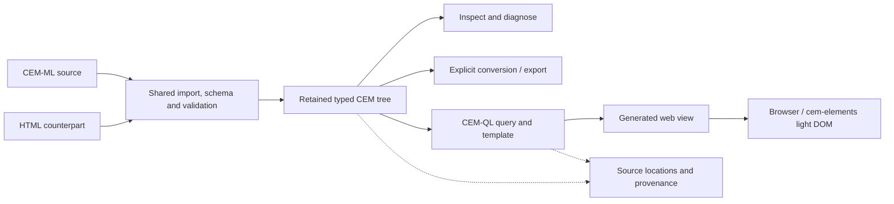

# Declarative Amsterdam 2026

> **Direction changed 2026-10-10:** establish a CEM manifesto and an
> adoption-focused platform pitch first, then map them into a website and
> slides. The [presentation plan](presentation-plan.md) owns current design and
> adoption planning; the [platform pitch](cem-platform-pitch.md) is the audience
> message. The [manifesto](cem-manifesto.md) states the principles and
> [capability evidence](platform-evidence.md) supports the claims. The syntax-led
> mini-tutorial below is retained as earlier planning and conference-source
> history; it is no longer the active narrative.

## Presentation brief

**CEM-ML: Evolutionary Architecture for the Declarative Web Stack**\
*A 60-minute mini-tutorial: follow one document from source to a working web view.*

Presenter: Sasha Firsov. Preparation snapshot: **2026-10-10**.
Repository reference: `9de4302a`; local documentation was also reviewed.

This is the earlier tutorial brief, timed outline, and preparation record.
That format introduced CEM-ML to people with no previous CEM-ML experience.
Participants would edit a small document and follow its validation, inspection,
conversion, transformation, and rendering. The architecture explanation grows
out of what they have just observed.

The [active checklist](../todo.md#current-work-declarative-amsterdam-2026-cem-presentation)
remains the execution authority. The [presentation plan](presentation-plan.md)
defines the current narrative; this document preserves the earlier brief and
conference-source history.

## Conference facts and correspondence status

| Item | Current evidence | Preparation consequence |
| --- | --- | --- |
| Conference | November 12–13, 2026, Science Park 125, Amsterdam; hybrid participation advertised. [Conference](https://declarative.amsterdam/) | Prepare readable screen sharing and downloadable materials for remote participants. |
| Session | Thursday November 12, 13:45 CET; the next break is 14:45. Thursday's default room is L016 / Hypatia. [Program](https://declarative.amsterdam/program) | The published timetable supports a 60-minute slot; the end is inferred from the following break. |
| Public title | The program heading is still “CEM-ML declarative document lifecycle engine.” Its description and bio already incorporate the updated material. [Program](https://declarative.amsterdam/program) | Reconcile the heading with the architecture title when organizer correspondence is available. |
| Session type | The [presentation index](https://declarative.amsterdam/presentations/?f_contributor_id=105) still labels it a presentation. The supplied update proposes a mini-tutorial. | Keep the interactive format as the working plan; verify organizer terminology. |
| Materials deadline | The [organizing committee's archived CFP](https://sourceforge.net/p/exist/mailman/message/59338226/) lists **October 12, 2026** for videos, tutorials, and papers. | Treat this as the immediate preparation date, two days after this snapshot. Check whether private correspondence changes the date or required deliverables. |
| Abstract length | The same CFP requests a 90–200-word proposal summary. The supplied draft mentions 300 characters and a collapsible section. | These may be different fields. Keep both a short teaser and a longer abstract; a 300-character rule has not been independently confirmed. |

The [official CFP](https://declarative.amsterdam/cfp) could not be retrieved
during this review; deadline and proposal-length evidence comes from the
organizing committee's archived announcement.

### Gmail research still to complete

Gmail access was unavailable when this document was prepared. The Gmail
integration was declined, and the browser-access fallback could not initialize
in this session. Correspondence can instead be reviewed from supplied thread
exports or pasted messages.
**No sent messages or organizer replies have been retrieved.** The supplied
“Dear Peter” text is user-provided background; its sent date and acceptance
status are unknown. Do not infer either from its wording.

Interpret “last year” first as calendar **2025**, then inspect the 2026
continuation for this session. Also cover the trailing year if the user meant
that interval. Use Gmail Sent for outgoing correspondence and read matching
threads for organizer replies:

```text
in:sent after:2024/12/31 before:2026/01/01 {to:declarative.amsterdam to:info@declarative.amsterdam to:pieter@benjamins.nl}
in:sent after:2025/12/31 before:2026/10/11 {to:declarative.amsterdam to:info@declarative.amsterdam to:pieter@benjamins.nl}
in:sent after:2025/10/09 before:2026/10/11 {to:declarative.amsterdam to:pieter@benjamins.nl}
after:2024/12/31 before:2026/10/11 {from:declarative.amsterdam from:pieter@benjamins.nl to:declarative.amsterdam to:pieter@benjamins.nl}
```

Record only preparation-relevant findings: message date, subject, sender or
recipient, link to the thread, requested change, and whether it was accepted
or remained a proposal. Specifically resolve:

- Feedback on accessibility, interaction, prerequisites, and the earlier session.
- Accepted title, mini-tutorial designation, duration, and any audience estimate.
- Exact October deadline, time zone, submission route, and required materials.
- Whether slides, a recording, tutorial files, or a paper are expected.
- Website text limits and whether the new title should replace the old heading.
- Any commitments about Studio, CLI availability, or supported installations.

### Source chronology available now

| Date | Source | What it establishes |
| --- | --- | --- |
| 2025 | Requested Gmail history; not yet retrieved | Historical organizer feedback remains unknown. |
| 2026-05-22 | Organizing committee CFP archive linked above | General tutorial guidance and October materials deadline. |
| 2026-08-26 | [GitHub discussion #24](https://github.com/EPA-WG/cem/discussions/24) | Public architecture framing and proposed 60-minute journey. |
| Undated | Session update supplied by Sasha in this request | Beginner audience, interactive format, planned public Studio and CLI, Node.js/Linux installation notes, presenter-led fallback. |
| 2026-10-10 | Public program and local repository review | Published slot, updated description/bio, remaining title mismatch, and current implementation boundaries. |

## Audience, promise, and learning outcomes

Assume familiarity with the idea of a structured document; explain every
CEM-specific term. HTML or XML experience helps but is not required. A laptop
is useful for participation, with the same checkpoints visible on the
presenter's screen for anyone following without one.

The central promise is concrete: **change one source document, diagnose a
problem, and see how the same structure can support different operations and
a visible result.** “Evolutionary architecture” means that a format adapter,
schema, transformation, or host can change while shared document contracts
continue to connect the stages.

By the end, participants should be able to:

1. Read a small CEM-ML node, attribute, text value, and namespace declaration.
2. Distinguish a syntax problem from a schema validation problem and locate
   a diagnostic in the source.
3. Inspect the document's structured representation and recognize what is
   retained when another input format enters the lifecycle.
4. Explain the difference between conversion and transformation.
5. Make one declarative change that appears in the rendered view.
6. Identify one extension point relevant to their own declarative workflow.

Teach terms at the moment they become useful: a **schema** supplies document
rules; a **typed tree** retains structure and value meaning; a **source map**
connects a result or diagnostic to source locations; a **template** describes
an output view; **light DOM** is ordinary document DOM that browser tools can
inspect directly.

## Introduction and biography

The architecture title is suitable for the session's broader argument. Lead
the spoken introduction with the exercise so newcomers know what they will
do before hearing the module names. The longer platform discussion can remain
in expanded website text and the final section of the session.

### Short teaser

Follow one small document from validation to a working web view. This
beginner-friendly CEM-ML mini-tutorial shows how shared schemas and
transformations let a declarative web architecture evolve.

This teaser is below 300 characters when its line breaks are replaced by spaces.

### Expanded abstract

How can a declarative web application evolve as its languages, tools, and
interfaces change? In this 60-minute mini-tutorial, we will explore that
question by following one small document through the CEM-ML platform.

No previous CEM-ML experience is required. Participants will read and edit a
simple sign-in view, introduce and repair a validation error, inspect its
structure, and compare another input format. We will then apply a declarative
transformation and render the result in a browser.

Each step reveals an architectural choice: what belongs to a schema, what the
common engine retains, and what a host or component adds. The closing discussion
connects the exercise to CEM-QL, the CLI, WebAssembly, declarative components,
and CEM-ML Studio. Participants can work through the prepared exercise or follow
the same checkpoints in a presenter-led walkthrough.

This is a proposed concise replacement for summary fields; the public
[GitHub introduction](https://github.com/EPA-WG/cem/discussions/24) remains the
reference for the full platform context.

### Biography

Sasha Firsov is a software architect and open-source developer focused on
declarative web architecture. For more than a decade, he has worked toward an
evolutionary web stack, beginning with JavaScript application containers and
Declarative Custom Elements, continuing with CEM-ML, and moving toward
Embeddable Progressive Applications. He participates in the W3C Web Components
Community Group and the XQuery and XSLT Extensions Community Group, and
contributes to WHATWG HTML discussions.

Biography based on the supplied text, with light editorial changes.

## Timed narrative and slide outline

Preserve the six intervals in the existing proposal. Installation belongs in
the preparation instructions, outside these 60 minutes.

| Time | Slides / focus | Presenter action and speaker note | Participant checkpoint |
| --- | --- | --- | --- |
| 0–3 | 1. One document, one visible result | Show the final sign-in view and its source side by side. State the six learning outcomes in plain language. | Recognize what will be changed. |
| 3–7 | 2. What should survive a change of tools? | Ask where validation rules and error locations live in participants' current workflows. Introduce shared document contracts through one example of a format or host change. | Name one piece of meaning that should survive. |
| 7–12 | 3. Read CEM-ML | Explain braces, attributes, the content separator, and the namespaces used by this document. Keep the source on screen. | Locate the heading, input, and button. |
| 12–17 | 4. First edit | Change a heading or label and compare the result. Explain only the syntax needed for this edit. | Make or predict the same visible change. |
| 17–23 | 5. A useful failure | Introduce the prepared schema violation, validate, locate its source-linked diagnostic, then repair it. Distinguish valid syntax from a document that violates a rule. | Explain the error and restore the valid state. |
| 23–29 | 6. Inspect the structure | Show the typed tree and the relevant source location. Explain what the engine knows beyond the source's spelling. | Find the same node in source and inspection. |
| 29–35 | 7. Another way into the lifecycle | Import the equivalent HTML document using its declared format, inspect it, and compare the agreed semantic fields. | Identify what is equivalent and what changes in representation. |
| 35–41 | 8. Ask and transform | Run one prepared query and one CEM-QL template over the retained document. Show the selected node and generated result together. | Predict the result, then edit one template value. |
| 41–47 | 9. Render and observe | Display the output through the prepared browser/runtime path and inspect its light DOM. Keep this a sign-in view; no authentication service is part of the exercise. | Observe the changed output in the browser. |
| 47–54 | 10. The platform behind the exercise | Map each demonstrated stage to its owner. Discuss adding a format or changing a host while retaining the same contracts. Use one tested component to connect the view to the wider platform. | Point to the contract their proposed change would extend. |
| 54–60 | 11. Your next declarative step | Invite use cases and questions. Show the handout, source, and verified access links. | State one experiment to try after the session. |

If the session runs late, shorten the platform catalogue to one diagram and
one extension example. Preserve the error-and-repair exercise, visible result,
and final discussion. The same checkpoints support a presenter-led run if
participant setup takes too long.

## Exercise design

Use the sign-in document already introduced publicly. Start from the existing
[canonical login example](../../examples/cem-ml/login.cem) and its
[HTML parity example](../../examples/semantic/login.html). The repository
example includes password and accessibility details beyond the short proposal;
choose and freeze the teaching version before recording screenshots or commands.

Use **HTML as the single alternate input format** for the core exercise.
The existing pair gives a concrete comparison surface. Other supported formats
belong in optional follow-up material. Compare named semantic fields and
rendered meaning; do not imply that all formats preserve identical lexical
spelling or that arbitrary conversions are lossless.

| Stage | Exercise design | Evidence to prepare |
| --- | --- | --- |
| Starting state | Open the valid source and show the finished view. | Exact source, declared schema/format identities, expected initial output. |
| Edit | Change one label or heading. | Before/after source and visible result. |
| Validate | Introduce a schema violation selected from a current verified case. Keep syntax valid so the distinction is clear. | Exact invalid edit, diagnostic code/location, non-success status, repaired success. Do not invent a diagnostic for the slides. |
| Inspect | Locate the edited node and its typed attributes. | Tabular CEM-ML inspection output and source-location evidence. |
| Convert | Import the HTML counterpart through the shared import boundary, then export an explicit target representation. | Agreed comparison fields, output identity, and documented differences. |
| Query / transform | Select part of the same document and apply one prepared CEM-QL template to produce the web view. | Exact query/template, output, and a visible effect from one participant edit. |
| Render | Show the generated view and the prepared `cem-elements` integration. | Browser result, ordinary DOM inspection, and the exact supported integration path. |

The query/template and validation-error variant are preparation work, not yet
verified tutorial files. Add their fixture actions to [docs/todo.md](../todo.md)
before creating them, following the repository's native-first workflow.

For structural inspection, follow the
[repository presentation boundary](../../CLAUDE.md#cem-ml-presentation-boundary):
use typed-tree CEM-ML text, the tabular formatter, terminal coloring where
appropriate, and plain text without ANSI escapes in saved outputs. JSON is an
explicit import/export or sidecar boundary, not the default AST display.

### Architecture diagram for slide 10



This is a teaching diagram. Every arrow shown in the live exercise needs a
tested command or host operation. Source locations are retained evidence
attached to the lifecycle; the diagram does not imply that every output
automatically emits a source-map file.

## Implementation claims and preparation boundaries

The following assessment is grounded in current local documentation. It is
not a new build, release, or end-to-end test report.

| Layer | Evidence reviewed | Safe presentation claim / remaining check |
| --- | --- | --- |
| Common engine | [cem_ml README](../../packages/cem_ml/README.md) | Shared parsing, validation, import/export, query and transformation services exist. Verify the exact tutorial sequence. |
| Native CLI | [cem_ml_cli README](../../packages/cem_ml_cli/README.md) | The command host uses common engine services. Public distribution and clean installation need separate evidence. |
| Node/browser hosts | [Universal CLI README](../../packages/cem-ml-cli-npm/README.md) | Both use a generated command grammar and the shared WASM runtime. Verify the specific commands against runtime capabilities. |
| CEM-QL and components | [CEM-QL](../../packages/cem_ql/README.md), [cem-elements](../../packages/cem-elements/README.md), [UI principle](../declarative-ui-principle.md) | Explain query/template ownership and declarative light-DOM composition. Demonstrate only selected verified behavior. |
| Studio | [Studio README](../../packages/cem-studio/README.md) | The documented workbench executes lifecycle operations and has project/offline support. A public URL, deployed version, and complete conference exercise remain to be checked. |
| Theme, Components, Site | [Preparation handoff](../presentation/declarative-amsterdam-2026-handoff.md), [active tasks](../todo.md) | Use as wider platform context. Component and application UI migration is still open; avoid presenting the entire platform as finished. |

The older [CLI feature summary](../cem-ml-cli-contract.md) explicitly contains
planned behavior. Use the selected binary's help, current implementation, and
recorded results to write final command instructions.

The [deployment contract](../cem-ml-deployment-contract.md) distinguishes npm/
WASM and Linux release units from local macOS/Windows native targets. The
supplied update's possible native macOS/Windows support must remain conditional
until a tested participant installation is available.

## Delivery, setup, and fallback

The preferred participant route is the planned public CEM-ML Studio site with
the exercise ready to open. The parallel route is a pinned CLI release with
tested Node.js and Linux instructions. Neither route is recorded as ready by
this document.

| Route | Evidence required before advertising it |
| --- | --- |
| Public Studio | Stable URL, deployed version, browser requirements, working exercise import, reset/recovery checkpoints, and complete run through rendering. |
| Node.js CLI | Exact package/version, registry availability, clean installation, supported Node version, and successful exercise on each advertised OS. |
| Linux native CLI | Exact release asset/version, architecture, installation/unpacking steps, and the complete exercise on a clean compatible host. |
| Native macOS or Windows | Separate host installation and exercise results before inclusion in participant instructions. |
| Presenter fallback | Local copy of all sources and dependencies, saved checkpoint outputs, readable screenshots or recording, and a rehearsed path independent of participant installation. |

The repository's npm deployment target is Node
`^22.12.0 || ^24.0.0`; this is a documented target, not an installation result
for the conference release. Record the actual versions tested.

Prepare a small handout with the starting source, one instruction and expected
result per checkpoint, recovery files, and verified links. Use large editor
text, show diagnostics as text as well as color, and keep the source/result
pair visible during edits. Remote attendees should receive the same files.

If a participant cannot run a step, have them predict the output, identify the
source location, or suggest the next edit while the presenter runs that step.
If the network fails, use the prepared local run; if a live operation fails,
move to its saved checkpoint and explain the observed failure briefly.

## Preparation sequence and acceptance evidence

Keep completion states in [docs/todo.md](../todo.md). This sequence supplies
the concrete deliverables for those existing actions.

1. **Resolve organizer requirements and the October review package.** Read the
   requested Gmail history, reconcile the title/type, and establish which
   artifacts must arrive by October 12 or any later agreed date.
2. **Freeze the teaching exercise.** Select the source revision, schema
   violation, query/template, alternate-input comparison, and expected outputs.
   Register any new fixture work in the active checklist.
3. **Prove participant access.** Verify the public Studio deployment and
   selected CLI releases from clean environments. Record failures and the
   presenter fallback when a route is not ready.
4. **Produce review materials.** Use this outline for the slides and speaker
   notes; include the exercise, setup handout, and any recording or paper
   required by the organizers.
5. **Rehearse and freeze.** Run the complete 60-minute session, test recovery
   checkpoints and offline presentation, and record versions and timings.
6. **Finalize the handoff.** Add the final artifact paths and verification
   evidence to the existing handoff before completing the presentation task set.

| Evidence field | Status on 2026-10-10 |
| --- | --- |
| Gmail message/thread references | Pending accessible correspondence or supplied thread exports |
| Exact organizer submission requirements | Pending correspondence review |
| Tutorial source revision and fixture set | Pending selection and verification |
| CLI release, installation commands, and OS/Node matrix | Pending clean-install tests |
| Public Studio URL and deployed version | Pending verification |
| Exact command transcript, diagnostics, and expected outputs | Pending tutorial run |
| Final slide/export and participant handout paths | Pending production |
| Rehearsal timing and fallback results | Pending rehearsal |

## Source register

- [GitHub discussion #24](https://github.com/EPA-WG/cem/discussions/24):
  public proposed introduction and timed journey.
- [Official conference program](https://declarative.amsterdam/program) and
  [presentation index](https://declarative.amsterdam/presentations/?f_contributor_id=105):
  published session placement, current title/type, description and biography.
- [Organizing committee CFP archive](https://sourceforge.net/p/exist/mailman/message/59338226/):
  general deadline and tutorial/summary guidance; check for later organizer changes.
- [Existing session proposal](../declarative.amsterdam.2026.md):
  local source for the original framing and example.
- [Preparation handoff](../presentation/declarative-amsterdam-2026-handoff.md):
  implementation checkpoint, previous materials, and return to implementation.
- Sasha's session update and biography supplied with this request:
  the public Studio commitment supplements the older local proposal.
- Gmail correspondence: not yet retrieved; add dated findings and available
  thread references when correspondence is supplied or becomes accessible.
