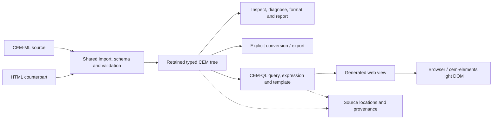

# Declarative Amsterdam 2026

> **Agenda alignment reviewed 2026-10-11:** the
> [conference program](https://declarative.amsterdam/program) defines Sasha
> Firsov's published session. The subjects and six time blocks in
> [discussion #24](https://github.com/EPA-WG/cem/discussions/24) remain covered
> below. The platform pitch supplies the reasons to adopt CEM; the document
> walkthrough makes those reasons visible. The [presentation minutes](#presentation-minutes)
> are the current working run, pending demonstration verification and rehearsal.

## Presentation brief

**Published title: CEM-ML declarative document lifecycle engine**

Presenter: **Sasha Firsov**. Thursday **November 12, 2026**, **13:45–14:45 CET
(UTC+1)**, **L016 / Hypatia**, Science Park 125, Amsterdam. The start and default
room are published; the end is inferred from the next break.
[Official program](https://declarative.amsterdam/program).

The GitHub proposal's architecture title remains the thematic framing, not a
confirmed replacement for the program heading. Preserve the publicly described
beginner walkthrough: participants edit the login document, diagnose and repair
an error, inspect and convert its structure, then transform it into a web view.
Use each step to show why CEM's shared contracts matter to their own work.

This document owns the source-aligned agenda and minute allocations. The
[presentation plan](presentation-plan.md) holds design ideas, adoption goals,
and optional examples; the [pitch](cem-platform-pitch.md) owns audience copy.
The [manifesto](cem-manifesto.md) supplies principles and the
[evidence record](platform-evidence.md) supplies capability boundaries.
Source review: **2026-10-11**. Preparation checkpoint: `33e18c99`.

**Participant resources:** [discussion #24](https://github.com/EPA-WG/cem/discussions/24)
is the stable link for slides and handouts. Keep the resource links there up to
date as materials become available. **Studio is not ready yet.**

**Slide deck created 2026-10-11:** [Google Slides](https://docs.google.com/presentation/d/1v5JEclFycuXuYk5Mnpwb0alxdKIi30J6XgvLBmawxI4/edit)
contains 25 main slides and four reference slides, with timed speaker notes and
the approved source colors. [Delivery and verification](deck-delivery.md)
records the PDF, editable source, demonstrated checkpoints and remaining gaps.
The [slide story](slide-story.md) expands the speaking notes. The opening
[DNA metaphor](opening-teaser.md) precedes the original dark title slide.

The [active checklist](../todo.md#current-work-declarative-amsterdam-2026-cem-presentation)
remains the execution authority. Deck production and agenda coverage do not
establish that runnable demonstrations, participant releases or rehearsal are ready.

## Conference facts and correspondence status

| Item | Current evidence | Preparation consequence |
| --- | --- | --- |
| Conference | November 12–13, 2026, Science Park 125, Amsterdam; hybrid participation advertised. [Conference](https://declarative.amsterdam/) | Prepare readable screen sharing and downloadable materials for remote participants. |
| Session | Thursday November 12, 13:45 CET; the next break is 14:45. Thursday's default room is L016 / Hypatia. [Program](https://declarative.amsterdam/program) | The published timetable supports a 60-minute slot; the end is inferred from the following break. |
| Public title | The current program heading is “CEM-ML declarative document lifecycle engine.” [Program](https://declarative.amsterdam/program) | Use the published title for session identification; no accepted rename is established. |
| Session format | The program places the session on tutorial day and its description promises participant edits and a document walkthrough. [Program](https://declarative.amsterdam/program) | Retain those activities within the adoption-focused presentation. Private organizer terminology remains unverified. |
| Materials deadline, earlier evidence | The [organizing committee's archived CFP](https://sourceforge.net/p/exist/mailman/message/59338226/), reviewed October 10, lists **October 12, 2026** for videos, tutorials, and papers. | Keep this preparation date pending confirmation of session-specific deliverables or a later agreement. This review rechecked the program and discussion, not the deadline. |
| Abstract length | The same CFP requests a 90–200-word proposal summary. The supplied draft mentions 300 characters and a collapsible section. | These may be different fields. Keep both a short teaser and a longer abstract; a 300-character rule has not been independently confirmed. |

The [official CFP](https://declarative.amsterdam/cfp) could not be retrieved
during the October 10 review; deadline and proposal-length evidence comes from the
organizing committee's archived announcement.

### Gmail research still to complete

Gmail access was unavailable when this document was prepared. The Gmail
integration was declined, and the browser-access fallback could not initialize
in this session. Correspondence can instead be reviewed from supplied thread
exports or pasted messages.
**No sent messages or organizer replies have been retrieved.** The supplied
“Dear Peter” text is user-provided background; its sent date and acceptance
status are unknown. Do not infer either from its wording.

Interpret “last year” first as calendar **2025**, then inspect the 2026
continuation for this session. Also cover the trailing year if the user meant
that interval. Use Gmail Sent for outgoing correspondence and read matching
threads for organizer replies:

```text
in:sent after:2024/12/31 before:2026/01/01 {to:declarative.amsterdam to:info@declarative.amsterdam to:pieter@benjamins.nl}
in:sent after:2025/12/31 before:2026/10/11 {to:declarative.amsterdam to:info@declarative.amsterdam to:pieter@benjamins.nl}
in:sent after:2025/10/09 before:2026/10/11 {to:declarative.amsterdam to:pieter@benjamins.nl}
after:2024/12/31 before:2026/10/11 {from:declarative.amsterdam from:pieter@benjamins.nl to:declarative.amsterdam to:pieter@benjamins.nl}
```

Record only preparation-relevant findings: message date, subject, sender or
recipient, link to the thread, requested change, and whether it was accepted
or remained a proposal. Specifically resolve:

- Feedback on accessibility, interaction, prerequisites, and the earlier session.
- Accepted title, mini-tutorial designation, duration, and any audience estimate.
- Exact October deadline, time zone, submission route, and required materials.
- Whether slides, a recording, tutorial files, or a paper are expected.
- Website text limits and whether the new title should replace the old heading.
- Any commitments about Studio, CLI availability, or supported installations.

### Source chronology available now

| Date | Source | What it establishes |
| --- | --- | --- |
| 2025 | Requested Gmail history; not yet retrieved | Historical organizer feedback remains unknown. |
| 2026-05-22 | Organizing committee CFP archive linked above | General tutorial guidance and October materials deadline. |
| 2026-08-26 | [GitHub discussion #24](https://github.com/EPA-WG/cem/discussions/24) | Public architecture framing and proposed 60-minute journey. |
| Undated | Session update supplied by Sasha in this request | Beginner audience, interactive format, planned public Studio and CLI, Node.js/Linux installation notes, presenter-led fallback. |
| 2026-10-10 | Public program and local repository review | Published slot, updated description/bio, remaining title mismatch, and current implementation boundaries. |
| 2026-10-11 | Program and discussion #24 rechecked after checkpoint `33e18c99` was pushed | Published title and tutorial activities retained; all six proposal blocks mapped into the current minutes. |
| 2026-10-11 | Sasha's preparation update | Studio is not ready; discussion #24 is the central destination for resource links and availability updates. |

## Published agenda and topic coverage

The [program](https://declarative.amsterdam/program) sets the public promise;
the [discussion timeline](https://github.com/EPA-WG/cem/discussions/24) supplies
the six-block structure. Preserve both while using the pitch to explain the
value of each result. The allocations below total **60 minutes**.

| Proposal interval | Subjects retained | Visible result or participation |
| --- | --- | --- |
| 0–7 | Cost of disconnected formats, validation, builds, runtimes, and source mappings; Evolutionary Architecture | Show the finished view, then identify a contract worth keeping as tools change. |
| 7–17 | Read and edit the public login document; minimal CEM-ML notation and namespaces | Participants change a label or heading; explain schema reuse, extension, and creation. |
| 17–35 | Validation, repair, typed inspection, source-linked diagnostics, and second-format conversion | Find and repair a schema violation, inspect a report, format the structure, and compare the HTML counterpart. |
| 35–47 | Declarative query, expression, and template; transformation and light-DOM rendering | Select content, transform it through a visible graph, and observe the edited result in a browser. |
| 47–54 | Rust engine and schema packages; native/WASM, CLI, Node/browser/worker hosts; `<cem-element>`; Consumer Semantic Theme, CEM Components, CEM Studio, CEM Site | One platform map connects each owner to the exercise and shows where new formats, modules, or hosts fit. |
| 54–60 | Participant use cases, extension opportunities, and questions | Identify a first integration and the evidence needed to adopt it. |

Formatting, reporting, and provenance are explicit parts of the walkthrough,
including a generated result's connection to source bytes and its transformation.
The format catalog is supporting context, with current support profiles stated.
Platform coverage includes ongoing migrations and release readiness; a program
description is not a verified release or benchmark.

The supplier example from the preliminary plan remains a companion for multiple
inputs and outputs, each in its own format. It can illustrate the next use case
on a diagram or the later website; it must not displace the promised login
edit, error repair, conversion, or working browser view. Deep scope-security,
SSR/resume, and performance demonstrations are optional material subject to
verification and rehearsal time.

## Audience, promise, and learning outcomes

Assume familiarity with the idea of a structured document; explain every
CEM-specific term. HTML or XML experience helps but is not required. A laptop
is useful for participation, with the same checkpoints visible on the
presenter's screen for anyone following without one.

The central promise is concrete: **change one source document, diagnose a
problem, and see how the same structure can support different operations and
a visible result.** “Evolutionary architecture” means that a format adapter,
schema, transformation, or host can change while shared document contracts
continue to connect the stages.

By the end, participants should be able to:

1. Read a small CEM-ML node, attribute, text value, and namespace declaration.
2. Distinguish a syntax problem from a schema validation problem and locate
   a diagnostic in the source.
3. Inspect the document's structured representation and recognize what is
   retained when another input format enters the lifecycle.
4. Explain the difference between conversion and transformation.
5. Make one declarative change that appears in the rendered view.
6. Identify one extension point relevant to their own declarative workflow.

Teach terms at the moment they become useful: a **schema** supplies document
rules; a **typed tree** retains structure and value meaning; a **source map**
connects a result or diagnostic to source locations; a **template** describes
an output view; **light DOM** is ordinary document DOM that browser tools can
inspect directly.

## Introduction and biography

Identify the session by its published title. Open with the finished view and
the pitch's wider goal: data processing services and applications that can
evolve across formats, source locations, and execution tiers. Use the login
document as the first visible proof. Give Evolutionary Architecture its own
explanation in the opening block, then show the relevant contracts at each
step. The platform map closes the loop from this example to broader adoption.

The teaser and abstract below are draft copy for supporting materials. They
do not replace the published program or establish an accepted title change.

### Short teaser

Follow one small document from validation to a working web view. This
beginner-friendly CEM-ML mini-tutorial shows how shared schemas and
transformations let a declarative web architecture evolve.

This teaser is below 300 characters when its line breaks are replaced by spaces.

### Expanded abstract

How can a declarative web application evolve as its languages, tools, and
interfaces change? In this 60-minute mini-tutorial, we will explore that
question by following one small document through the CEM-ML platform.

No previous CEM-ML experience is required. Participants will read and edit a
simple sign-in view, introduce and repair a validation error, inspect its
structure, and compare another input format. We will then apply a declarative
transformation and render the result in a browser.

Each step reveals an architectural choice: what belongs to a schema, what the
common engine retains, and what a host or component adds. The closing discussion
connects the exercise to CEM-QL, the CLI, WebAssembly, declarative components,
and CEM-ML Studio. Participants can work through the prepared exercise or follow
the same checkpoints in a presenter-led walkthrough.

This is a proposed concise replacement for summary fields; the public
[GitHub introduction](https://github.com/EPA-WG/cem/discussions/24) remains the
reference for the full platform context.

### Biography

Sasha Firsov is a software architect and open-source developer focused on
declarative web architecture. For more than a decade, he has worked toward an
evolutionary web stack, beginning with JavaScript application containers and
Declarative Custom Elements, continuing with CEM-ML, and moving toward
Embeddable Progressive Applications. He participates in the W3C Web Components
Community Group and the XQuery and XSLT Extensions Community Group, and
contributes to WHATWG HTML discussions.

Biography based on the supplied text, with light editorial changes.

## Presentation minutes

Working allocation for **November 12, 13:45–14:45 CET**, preserving the six
proposal intervals. The numbered beats guide slide preparation; final slide
count and demonstration timing depend on rehearsal. Installation belongs in
the preparation instructions, outside these 60 minutes.

| Elapsed | Clock (CET) | Beat / focus | Presenter action and adoption point | Participant checkpoint |
| --- | --- | --- | --- | --- |
| 0–3 | 13:45–13:48 | 1. A useful result | Show the finished login view beside its source. Connect it to the wider cost of integrating data services and applications across formats, locations, and tiers. | Recognize the result and what will change. |
| 3–7 | 13:48–13:52 | 2. Evolutionary Architecture | Show how disconnected formats, validators, builds, runtimes, and source mappings repeat work. Follow the lifecycle from sources and schemas to deployment; identify contracts that survive a format or host change. | Name a change their system must accommodate. |
| 7–12 | 13:52–13:57 | 3. Familiar structure, another notation | Put the login's HTML/XML structure beside CEM-ML. Explain only the nodes, attributes, content separator, and namespaces needed to read it. | Locate the heading, input, and button. |
| 12–17 | 13:57–14:02 | 4. Make the first change | Edit a heading or label. Introduce the schema behind it: **Pick, extend, or create your own schemas.** Explain how rules support development as well as validation. | Make or predict the same edit. |
| 17–23 | 14:02–14:08 | 5. Find and repair a failure | Introduce a schema violation while keeping syntax valid. Validate, follow the diagnostic to its source, then repair it. | Explain the failure and restore the valid state. |
| 23–29 | 14:08–14:14 | 6. Inspect, format, and report | Inspect typed structure and source locations. Show a concise report and pretty/tabular formatting, including the selected color presentation. Make the retained meaning visible beyond the original spelling. | Find the same node in source and inspection; read its report. |
| 29–35 | 14:14–14:20 | 7. Change the input format | Import the HTML counterpart and export an explicit representation. Compare agreed semantic fields, retained source identity, and mapping limits. Briefly locate it in the schema catalog. | Explain what stays equivalent and what changes. |
| 35–41 | 14:20–14:26 | 8. Query and transform | Compare a supported XPath question with CEM-QL. Use a query, expression, and template to produce the view; show the graph and trace a generated result to source bytes and its transformation. | Predict the output, then change one template value. |
| 41–47 | 14:26–14:32 | 9. Render and embed | Show the edited result through the verified browser and `<cem-element>` path. Inspect light DOM; identify declarative data, events, queries, and templates and the runtime machinery they use. Explain the embedding opportunity. | Observe the changed view and inspect its DOM. |
| 47–54 | 14:32–14:39 | 10. Locate the platform | Map Rust engine/schema packages, native/WASM, CLI/library, Node/browser/worker hosts, `<cem-element>`, Consumer Semantic Theme, CEM Components, CEM Studio, and CEM Site. Connect them to the exercise, extensible connectors, and six-layer scope insulation; identify current support and goals. | Locate an extension or execution path for their own work. |
| 54–60 | 14:39–14:45 | 11. Choose a first use case | Take questions about languages, schemas, modules, and application layers. Show the handout and link/QR code to discussion #24 for resources and updates; invite one bounded adoption experiment. | State a use case and bookmark the resource discussion. |

Keep the source visible throughout the lifecycle. The login is a view, not an
authentication service. Familiar comparisons must use verified language support;
the platform map must distinguish available operations from planned capabilities.

If time slips, omit companion variants and shorten exposition or catalog detail.
Preserve the login edit, diagnosis and repair, inspection, conversion, rendered
result, required platform map, and final six minutes. The same checkpoints
support a presenter-led run when a participant cannot complete a local step.

## Exercise design

### Slide mapping for the working minutes

| Elapsed | Slides | Coverage |
| --- | --- | --- |
| 0–3 | 1–3 | Introduction and visible login result |
| 3–7 | 4–5 | Adoption proposition and Evolutionary Architecture |
| 7–12 | 6–7 | XML/CEM-ML comparison and minimal notation |
| 12–17 | 8–9 | First edit; pick, extend, or create schemas |
| 17–23 | 10–11 | Real schema failure and repair |
| 23–29 | 12–13 | Typed inspection, tabular formatting, colors and reports |
| 29–35 | 14–15 | Verified XML route and multi-input/output companion |
| 35–41 | 16–18 | Verified query comparison; transformation and provenance contracts |
| 41–47 | 19–20 | Static preview, declarative runtime explanation and embedding |
| 47–54 | 21–24 | Platform map, hosts, scope insulation and performance mechanisms |
| 54–60 | 25 | Questions and adoption; resource link and QR |

Slides 26–29 are reference material outside the timed run. The current XML
checkpoint supplements the promised HTML input exercise. Complete HTML import,
template execution, interactive `<cem-element>` output and generated-result
tracing remain preparation work, as recorded in [deck delivery](deck-delivery.md).

### Required tutorial checkpoints

Use the sign-in document already introduced publicly. Start from the existing
[canonical login example](../../examples/cem-ml/login.cem) and its
[HTML parity example](../../examples/semantic/login.html). The repository
example includes password and accessibility details beyond the short proposal;
choose and freeze the teaching version before recording screenshots or commands.

Use **HTML as the single alternate input format** for the core exercise.
The existing pair gives a concrete comparison surface. Show broader format
support briefly in the platform context; use the supplier companion for deeper
multi-input/output work on the website or in questions. Compare named semantic
fields and rendered meaning; do not imply that all formats preserve identical
lexical spelling or that arbitrary conversions are lossless.

| Stage | Exercise design | Evidence to prepare |
| --- | --- | --- |
| Starting state | Open the valid source and show the finished view. | Exact source, declared schema/format identities, expected initial output. |
| Edit | Change one label or heading. | Before/after source and visible result. |
| Validate | Introduce a schema violation selected from a current verified case. Keep syntax valid so the distinction is clear. | Exact invalid edit, diagnostic code/location, non-success status, repaired success. Do not invent a diagnostic for the slides. |
| Inspect / format / report | Locate the edited node and its typed attributes; present a concise report. | Pretty and tabular CEM-ML output, selected color presentation, plain saved output, and source-location evidence. |
| Convert | Import the HTML counterpart through the shared import boundary, then export an explicit target representation. | Agreed comparison fields, output identity, and documented differences. |
| Query / transform | Select part of the same document, evaluate an expression, and apply one prepared CEM-QL template to produce the web view. | Exact query/expression/template, graph, output, source-byte and transformation trace, and a visible effect from one participant edit. |
| Render | Show the generated view through the prepared `<cem-element>` integration. | Browser result, light-DOM inspection, declarative data/events/query/template bindings, and the exact supported integration path. |

The query/template and validation-error variant are preparation work, not yet
verified tutorial files. Add their fixture actions to [docs/todo.md](../todo.md)
before creating them, following the repository's native-first workflow.

For structural inspection, follow the
[repository presentation boundary](../../CLAUDE.md#cem-ml-presentation-boundary):
use typed-tree CEM-ML text, the tabular formatter, terminal coloring where
appropriate, and plain text without ANSI escapes in saved outputs. JSON is an
explicit import/export or sidecar boundary, not the default AST display.

### Architecture diagram for the platform overview



This is a teaching diagram. Every arrow shown in the live exercise needs a
tested command or host operation. Source locations are retained evidence
attached to the lifecycle; the diagram does not imply that every output
automatically emits a source-map file.

## Implementation claims and preparation boundaries

The following assessment is grounded in current local documentation. It is
not a new build, release, or end-to-end test report.

| Layer | Evidence reviewed | Safe presentation claim / remaining check |
| --- | --- | --- |
| Common engine | [cem_ml README](../../packages/cem_ml/README.md) | Shared parsing, validation, import/export, query and transformation services exist. Verify the exact tutorial sequence. |
| Native CLI | [cem_ml_cli README](../../packages/cem_ml_cli/README.md) | The command host uses common engine services. Public distribution and clean installation need separate evidence. |
| Node/browser hosts | [Universal CLI README](../../packages/cem-ml-cli-npm/README.md) | Both use a generated command grammar and the shared WASM runtime. Verify the specific commands against runtime capabilities. |
| CEM-QL and components | [CEM-QL](../../packages/cem_ql/README.md), [cem-elements](../../packages/cem-elements/README.md), [UI principle](../declarative-ui-principle.md) | Explain query/template ownership and declarative light-DOM composition. Demonstrate only selected verified behavior. |
| Studio | [Studio README](../../packages/cem-studio/README.md); Sasha's October 11 update | Workbench implementation exists, but Studio is not ready for participant use. Present its role as work in progress; add access links to discussion #24 when ready. |
| Theme, Components, Site | [Preparation handoff](../presentation/declarative-amsterdam-2026-handoff.md), [active tasks](../todo.md) | Use as wider platform context. Component and application UI migration is still open; avoid presenting the entire platform as finished. |

The older [CLI feature summary](../cem-ml-cli-contract.md) explicitly contains
planned behavior. Use the selected binary's help, current implementation, and
recorded results to write final command instructions.

The [deployment contract](../cem-ml-deployment-contract.md) distinguishes npm/
WASM and Linux release units from local macOS/Windows native targets. The
supplied update's possible native macOS/Windows support must remain conditional
until a tested participant installation is available.

## Delivery, setup, and fallback

Use [discussion #24](https://github.com/EPA-WG/cem/discussions/24) as the single
resource destination in slides, QR codes, handouts, and the presentation website.
Keep links to examples, CLI releases, installation notes, recordings, and Studio
there as each becomes available. Slide copy: **“Resources and updates.”**

Studio is not ready and is not required to draft the slides. Keep it in the
platform overview as work in progress. Prepare the walkthrough through a
verified CLI/browser path with a presenter-led fallback; participant CLI access
still requires a pinned release and tested Node.js/Linux instructions.

| Route | Evidence required before advertising it |
| --- | --- |
| Public Studio — future route | Add a link to discussion #24 after verifying the URL, deployed version, browser requirements, exercise import, reset/recovery, and complete run through rendering. |
| Node.js CLI | Exact package/version, registry availability, clean installation, supported Node version, and successful exercise on each advertised OS. |
| Linux native CLI | Exact release asset/version, architecture, installation/unpacking steps, and the complete exercise on a clean compatible host. |
| Native macOS or Windows | Separate host installation and exercise results before inclusion in participant instructions. |
| Presenter fallback | Local copy of all sources and dependencies, saved checkpoint outputs, readable screenshots or recording, and a rehearsed path independent of participant installation. |

The repository's npm deployment target is Node
`^22.12.0 || ^24.0.0`; this is a documented target, not an installation result
for the conference release. Record the actual versions tested.

Prepare a small handout with the starting source, one instruction and expected
result per checkpoint, recovery files, and the discussion #24 resource link.
Use large editor text, show diagnostics as text as well as color, and keep the source/result
pair visible during edits. Remote attendees should receive the same files.

If a participant cannot run a step, have them predict the output, identify the
source location, or suggest the next edit while the presenter runs that step.
If the network fails, use the prepared local run; if a live operation fails,
move to its saved checkpoint and explain the observed failure briefly.

## Preparation sequence and acceptance evidence

Keep completion states in [docs/todo.md](../todo.md). This sequence supplies
the concrete deliverables for those existing actions.

1. **Resolve remaining organizer requirements and the October review package.**
   Use the current published title and slot. Review correspondence when
   accessible and establish which artifacts must arrive by October 12 or any
   later agreed date; private agreements remain unverified.
2. **Freeze the teaching exercise.** Select the source revision, schema
   violation, inspection/report, query/expression/template, alternate-input
   comparison, transformation trace, and expected outputs.
   Register any new fixture work in the active checklist.
3. **Prove the selected delivery route.** Verify CLI releases and installation
   instructions from clean environments, plus the presenter fallback. Prepare
   verified resource links for discussion #24. Add Studio access there when
   it is ready; its release is not a prerequisite for drafting the slides.
4. **Produce review materials.** Use these minutes for slides and speaker
   notes, with pitch copy and the plan's design ideas. Include the exercise,
   setup handout, and any recording or paper required by the organizers.
5. **Rehearse and freeze.** Run the complete 60-minute session, test recovery
   checkpoints and offline presentation, and record versions and timings.
6. **Finalize the handoff.** Add the final artifact paths and verification
   evidence to the existing handoff before completing the presentation task set.

| Evidence field | Status on 2026-10-11 |
| --- | --- |
| Published agenda and proposal timeline coverage | Reviewed; all six blocks and public lifecycle/platform subjects mapped into 60 working minutes |
| Stable participant resource link | Discussion #24 selected; add and update resource links as materials become available |
| Gmail message/thread references | Pending accessible correspondence or supplied thread exports |
| Exact organizer submission requirements | Pending correspondence review |
| Tutorial source revision and fixture set | Pending selection and verification |
| CLI release, installation commands, and OS/Node matrix | Pending clean-install tests |
| Public Studio URL and deployed version | Not ready, confirmed by Sasha; future access to be linked from discussion #24 |
| Exact command transcript, diagnostics, and expected outputs | [Slide asset evidence](deck-delivery.md#verified-content) verifies formatting, schema repair and query parity; complete tutorial run remains open |
| Slide/export and participant handout paths | [Native Slides, editable source and PDF delivered](deck-delivery.md); participant handout remains open |
| Rehearsal timing and fallback results | Pending rehearsal |

## Source register

- [GitHub discussion #24](https://github.com/EPA-WG/cem/discussions/24):
  public proposed introduction and six-block timeline; rechecked 2026-10-11.
  Also the selected destination for participant resource links and updates.
- [Official conference program](https://declarative.amsterdam/program):
  published title, speaker, slot, description, and biography; rechecked 2026-10-11.
- [Presentation index](https://declarative.amsterdam/presentations/?f_contributor_id=105):
  supporting session listing reviewed 2026-10-10.
- [Organizing committee CFP archive](https://sourceforge.net/p/exist/mailman/message/59338226/):
  general deadline and tutorial/summary guidance; check for later organizer changes.
- [Existing session proposal](../declarative.amsterdam.2026.md):
  local source for the original framing and example.
- [Preparation handoff](../presentation/declarative-amsterdam-2026-handoff.md):
  implementation checkpoint, previous materials, and return to implementation.
- Sasha's session update and biography supplied with this request:
  earlier public Studio plans supplement the older local proposal. Sasha's
  October 11 follow-up confirms Studio is not ready and selects discussion #24
  for links as materials become available.
- Gmail correspondence: not yet retrieved; add dated findings and available
  thread references when correspondence is supplied or becomes accessible.
