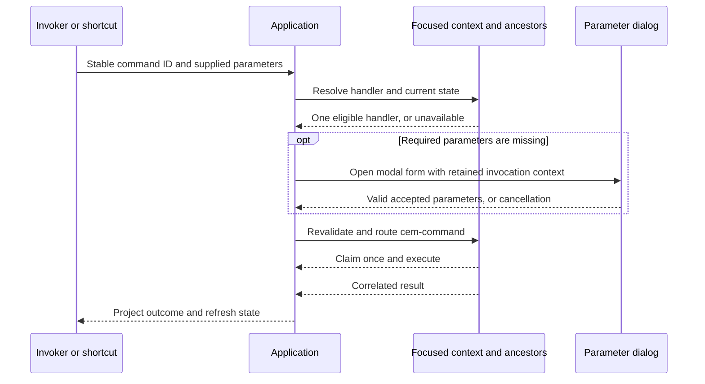

# Virtual applications and orchestration

**Status:** design proposal, 2026-11-23. This document proposes
`cem-application`; it does not introduce a shipped component, capability, or
binding syntax. Read it with [command.md](command.md) and
[localization.md](localization.md). Existing accepted interaction and lifecycle
contracts remain authoritative until an explicit implementation revision adopts
these additions.

**Owner revision — virtual applications:** `cem-application` is an embeddable
microapplication boundary, with a native CEM context, downward container
authority, application management and portable-state goals. This revision
supersedes the earlier description as only a command/localization region.
Focus-to-activation policy remains **TBD**; the contracts below do not select it.

**Owner revision — insulation-first and guarded APIs, 2026-11-24:** each app
starts with a private admitted environment. Browser services are available to
CEM app code only through `cem-elements` guardrails; app code receives no
unrestricted browser API. This replaces the earlier inherited-by-default mode
and the suggestion that CEM-only virtualization necessarily requires a separate
browser realm. Native scope syntax and implicit property inheritance are the
primary candidate, with explicit cross-app bindings and `embed-page` insulation
parity as described below. These are proposed contracts, not implementation
or security-conformance receipts.

## Purpose

`cem-application` represents one virtual application. The top-level instance
matches the page; embedded instances start with their own context, storage and
logical URL and can explicitly inherit/share selected container-provided inputs.
The container can override an embedded app's context; an embedded app cannot
override its container or siblings. Inheritance is a choice of inputs, never
upward write authority.

Each instance also coordinates resource-backed commands and localization. A
menu item, toolbar action, command palette entry, keyboard
shortcut, or native-shell menu invokes the same stable command ID. The
application resolves a contextual handler, collects missing arguments when
necessary, and records a correlated outcome. A locale change replaces resource
presentations without changing command identity or executing commands again.

Application management follows MDI-style separation between a container manager
and managed children; it does not require draggable desktop windows. The virtual
application remains distinct from the existing compiled
`cem-application-declaration/1` artifact. It reuses native CEM context, resource
and checkpoint semantics instead of inventing a parallel application engine.

## Insulation and browser boundaries

Insulation is the default app contract, enforced where CEM elements expose
browser services. Every storage, location, network, document/DOM, event,
stylesheet and host-service operation must carry its admitted app context and
permissions. No direct `window`, native `Storage`, host DOM owner or equivalent
escape capability is given to CEM app code. The trusted generic runtime may use
native browser APIs internally; it must not leak that authority to consumers.

The runtime supplies app-local state, singleton services, logical globals and
unprefixed resource/storage names. These patterns are encouraged within the
app's environment: authors should not manually prefix keys or coordinate with
unrelated vendors to prevent host side effects. App-local globals mean values
owned by the admitted app execution context, not assignments to the host page's
`globalThis`. Components remain declarative under the existing UI principle.

This complete mediation makes CEM-only app virtualization possible without
wrapping native JavaScript globals or requiring a separate browser realm per
app. A named scope alone is insufficient: the generic capabilities must apply
its context at every effect and retained state/event boundary. Missing guardrails
refuse the operation rather than silently exposing an ambient browser API.

Insulation also supports independent dependency versions, singleton lifetimes,
tests, tenant/account state, save/clone, and pause/offload. Immutable source or
compiled resources can be reused without joining mutable execution state.
Isolation does not promise unlimited CPU/memory or an independent physical
process; execution budgets and shared-runtime ownership still apply.

App-private version support is an implementation requirement, not an existing
consequence of naming a scope. The current browser declaration contract has
document-global public-tag uniqueness and rejects incompatible definitions.
Add generic context-aware declaration/export routing, or use a suitable host
document boundary, before admitting conflicting app versions. Keep existing
collision checks; never silently reuse another app's incompatible constructor.
Do not expose raw `customElements` as a way around the private declaration
contract. [Current declaration boundary](../../../docs/cem-element-design.md).

### Iframe and embedded behavior parity

The same CEM microapplication must observe the same logical API behavior when
run in an iframe or embedded in a `cem-application` container, given equivalent
admitted settings/capabilities. Both deployments use CEM browser-service
guardrails. Switching placement must not change storage key visibility, named
scope sharing, logical navigation, resource lookup or command authority.
The actual DOM ancestry, browser origin and permission/activation constraints
still differ; adapters preserve the contract without inventing unavailable
browser permissions. Focus/active-app policy remains TBD in both deployments.

An iframe on a different origin can add browser-enforced separation for a hybrid
CEM+JavaScript app. An ordinary same-origin iframe supplies a separate document
and JavaScript global but does not itself enforce the intended parent-DOM and
shared-storage boundary; the CEM application security layer is still required.
Additional sandbox origin restrictions are a separate browser policy, not a
substitute for app service virtualization.
[HTML iframe model](https://html.spec.whatwg.org/multipage/iframe-embed-object.html#the-iframe-element),
[Web Storage](https://html.spec.whatwg.org/multipage/webstorage.html).

For hybrid code, every app-visible service still needs the admitted facade;
unrestricted same-page JavaScript that can reach the host's native objects is
outside that profile. This is not permission to add JavaScript to production
`cem-components`. Cross-origin adapters use admitted messages/ports for the same
manager/services rather than exposing raw host objects. Parent overrides remain
policy/context inputs; they do not require arbitrary access to child memory.

### Insulation parity reference: `embed-page`

Retain [EPA-WG/embed-page](https://github.com/EPA-WG/embed-page) as the concrete
insulation-parity reference. At reviewed commit
`dde611e450ef7d901df6054a6545250e0862af49`, both storage adapters prefix native
keys with `<EPA>{scopeIdentity}</EPA>`. Default instance identity is private;
`named` uses `name || id`; page/host/domain modes derive the identity from the
virtual location. Reads/writes/removals use the prefix, and enumeration/clearing
are scope-filtered. [Adapter](https://github.com/EPA-WG/embed-page/blob/dde611e450ef7d901df6054a6545250e0862af49/embed-page.js#L49-L97),
[prefix selection](https://github.com/EPA-WG/embed-page/blob/dde611e450ef7d901df6054a6545250e0862af49/embed-page.js#L455-L467).

Its [storage tests](https://github.com/EPA-WG/embed-page/blob/dde611e450ef7d901df6054a6545250e0862af49/demo/storage.html.test.js#L30-L67)
assert private local/session reads and writes, shared values and peer-only
notifications in named scopes, and unchanged host keys. This is existing
reference evidence, not a claim that CEM already implements the adapters or
that every edge case has been verified. CEM adopts the behavior at its element
capability boundary; it does not need the project's native-JavaScript wrappers.

## Native context and downward authority

An application's effective context is a native CEM context frame, represented at
the CEM AST/artifact boundary. CLI, native, WASM, browser and SSR must resolve
equivalent inputs identically. Application instance identity associates a frame
with its owner; it never replaces the native scope identity or authored source
bindings. See [context propagation](../../../docs/cem-ml-resource-lifecycle.md#context-tree-propagation)
and [native namespace scopes](../../../docs/cem-ml-stack-design.md).

| Context family | Inherited or app-owned inputs | Container authority |
| --- | --- | --- |
| Language/schema | Namespaces, default namespace, schema/content-type bindings, registered plugins and version pins | Supply child bindings/overrides within host registration and policy bounds |
| Resolution | Module/resource maps, source and resolver bases, accepted types, integrity and cache policy | Override permitted mappings or block them; no child can relax ancestor restrictions |
| Resources | Command definitions, message catalogs, assets, shortcut profiles and other typed values | Replace the entire resource set or specific declared values/fields |
| Environment | Requested languages, theme variations, formatting and accessibility preferences | Supply child settings/overrides; child settings affect only that child/subtree |
| Services | Storage, logical location/history, clipboard/network/host endpoints | Grant private, inherited or explicitly shared providers; revoke/rebind under a new context revision |
| Runtime | Budgets, lifecycle admission, scheduling priority, checkpoint/export policy and diagnostic boundaries | Manage descendants within enclosing host limits |

Every app starts from its declared context/defaults and private storage/location
providers. There is no ambient fallback to parent-app resources/services.
Standard browser/environment preferences remain available through an admitted
read-only provider. Ancestor policy ceilings and explicit container overrides
always apply; insulation cannot escape host authority.

Compose selected families through explicit native/scoped bindings supplied or
approved by the container. Declare whether each inherited input is a read-only
value, resource view or shared mutable service. No whole-app `context-mode` or
generic inheritance flag is needed, and sharing never disables guardrails.
A binding to a shared store is a deliberate exception
to private storage, not accidental fallback. A child can propose a different
local module map/namespace set for its own frame; it cannot rewrite any ancestor
frame. The parent can approve, replace or restrict that proposal.

Container overrides are a separately owned input to the child frame. Their
provenance records the container and targeted child instance. A child cannot
forge that input or relabel its own values as container policy. Ancestors can
constrain or override a descendant's effective inputs; an intermediate app
cannot cancel an enclosing mandatory restriction. Parent ownership does not
automatically issue cross-scope node or DOM-placement grants: keep
[directed source/placement admission](../../../docs/cem-element-granted-placements-design.md).

### Scope syntax and property inheritance: primary candidate

Reuse native CEM scope ownership and existing host-bound typed properties.
A `cem-application` instance owns a native context frame; it need not require
an extra anonymous wrapper, repeated explicit parent references or an authored
context-root ID. Anonymous typed scopes and schema/namespace properties retain
their existing meanings. A module-map `{scope @prefix=...}` is a URL-prefix
mapping entry, not an application group or a general insulation switch.

There is no general authored `inherit`/`inherited` flag in current CEM-ML.
Ordinary scope properties inherit implicitly when omitted; a local declaration
overrides within its scope, and scope exit restores the enclosing relationship.
The native code also distinguishes an omitted policy from an explicit default.
[Scope syntax](../../../docs/cem-ml-syntax.md#schema-scoping-a),
[policy representation](../../../packages/cem_ml/src/schema/reference_policy.rs).

For virtual apps, first establish the private admitted app environment, then
apply that native inheritance inside it. An omitted app property inherits the
effective value in this environment; it does not reopen ambient parent-app
lookup. Inheritance from another app is an explicit admitted binding, not a
change to native lexical rules. Explicit invalid/pending bindings remain
invalid/pending rather than falling back to inherited authority. Empty/reset
values keep their schema-defined meanings; no generic null/empty inheritance
sentinel is introduced here.

Keep source-document URI, resolution base and app location/history distinct.
The former two already have native context machinery. App location/storage
providers and their cross-app bindings are a proposed generic consumer contract,
not new parser keywords. If undoing a local default later requires an explicit
inherit/reset marker, define its per-property schema semantics separately;
this proposal does not present such a marker as existing syntax.

### Named groups and virtual sets

A named application scope can serve as a handle for a host-admitted native
environment/group. Its naming/lookup consumer is proposed work, separate from
module-map prefix scopes and public named CSS membership. Resolve a local name
to an immutable admitted group/provider identity; matching strings alone never
authorize joining a vendor's environment.

| Virtual set | Private default | Explicit host-approved sharing |
| --- | --- | --- |
| Native context | App-owned bindings and source context | Selected schema/namespace/default-resource inputs |
| Execution state | App-local globals, evaluated modules and singleton instances | Deliberate trusted execution/service group with defined lifetime |
| Modules/resources | App's admitted resolution context | Immutable code/compiled artifact/catalog reuse without shared mutable evaluation state |
| Storage | App-private local/session partitions | Selected named store with separate read/write/subscribe rights |
| Location/history | App-private navigation provider | Container-selected route projection or shared navigation service |
| Environment | Read-only browser/host preference inputs | Selected container locale/theme settings |
| Host capabilities | Only declared admitted endpoints | Specific command/network/clipboard/service grants |

Common-vendor apps can share selected sets while keeping other sets private.
Vendor/package identity, user/tenant context and group membership are checked by
the container; self-declared vendor strings, CDN origin, DOM ancestry or a group
name do not supply permission. Joining a shared execution group is stronger than
sharing a resource map or store. A member cannot erase group state or retire
shared physical owners on close while peers remain. Parent restrictions remain
effective across all groups, and revocation advances admission epochs.

Browser same-origin policy is an enforcement input, not the grouping algorithm.
Same-origin apps may have distinct CEM sets; different-origin frames may share a
narrow provider through an admitted bridge. CEM does not relax browser-origin
rules to implement named sharing or infer vendor trust from an origin match.

### Resolution and resource overrides

Use existing native lookup rules, not a universal new merge algorithm. Non-CSS
module resolution already lets outer mappings override inner defaults. CSS
resolution intentionally selects the closest applicable mapping, while retaining
all ancestor blocks and resource restrictions. App insulation controls which
default frames/providers are supplied; it does not reverse these resolver rules.
To enforce a container-selected CSS resource, construct the admitted child map
accordingly or reject incompatible configuration; do not patch a browser import
map or silently change native precedence.
[Scoped map contracts](../../../docs/scoped-css-module-maps.md#existing-boundaries).

Namespace changes remain lexical and downward: they affect subsequent uses in
their scope, not expanded names already resolved or bindings in a parent. A
container namespace override seeds/validates the child's context before
evaluation. A required binding conflicts with a disallowed child redeclaration
by producing a diagnostic, not by retroactively reinterpreting retained nodes.

Application resources follow this same context pattern. Container-owned
overrides may replace all resources, one resource, or schema-declared fields,
for example only a command's name and help. Missing fields use the admitted
underlying resource; explicit empty/removal values follow that field's schema.
Whole-message/plural units and executable/schema-bearing values are atomic unless
their schema explicitly defines a safe field overlay. Revalidate the effective
resource before publishing it. Semantic overrides use admitted context authority;
a translator bundle still cannot replace a handler or schema.

Resolve semantic definitions/overrides before localization. A presentation-only
override leaves the command's semantic revision unchanged; replacing its schema
or endpoint creates a new semantic revision and fences pending invocations.
Keep source and override provenance, context/grant identity and all relevant
revisions in cache/publication keys. Child-local edits never mutate a shared
parent tree. Use native retained values and references, not a deep-merged
JavaScript catalog or a second format-specific evaluator.

Per-app CEM module maps are native resolver state. Browser JavaScript import maps
operate at the document/global boundary with their own merge constraints; they
are not a mechanism for installing arbitrary subtree environments.
[HTML import maps](https://html.spec.whatwg.org/multipage/webappapis.html#import-maps).

### Storage and URL providers

The top-level app normally binds its location provider to page navigation and
its storage provider to a page/application partition. Every embedded child gets
an independent logical URL/history and stable storage partition by default.
A child can explicitly share a provider or receive a scoped projection supplied
by the parent.
Make those relationships explicit rather than sharing through DOM ancestry.

Keep source-document URI, resource resolver base and logical app route URL
distinct. Child navigation changes its own logical location; only the container
decides whether/how that location projects into the page URL/history, including
Back/Forward. Shared navigation requests still pass the container's coordinator;
children do not directly write `window.location` or global history.
[HTML location/history](https://html.spec.whatwg.org/multipage/nav-history-apis.html).

Every CEM-managed storage/location reader and writer must resolve through the
effective provider, including subscriptions, forms, resource loaders and host
services. Missing or denied private providers fail explicitly, without falling
back to ambient origin storage/page location. Private partitions are keyed by
stable provider/instance identity; explicitly named storage scopes resolve to
stable admitted store identities. Manager names and localized titles are aliases,
not an implicit instruction to select/move the app's persisted keys.
Each other browser service, including cookies, IndexedDB and network credentials,
requires its own admitted adapter/policy; Web Storage prefixing does not define
their semantics automatically. Native origin ownership remains a browser fact;
apps see their granted logical providers, not ambient native objects.

These generic provider bindings are new work. Current document-global
storage/location behavior cannot be described as already insulated.

### Local/session storage virtualization

Apply automatic partitioning inside the generic CEM storage capabilities. App
declarations use ordinary keys such as `settings` or `draft`; no manual prefix
or native API wrapper is required. The adapter selects the app-private or
explicit named-scope store and maps each logical key into its backing keyspace.
The same contract applies to local and session storage, with their different
persistence/session lifetimes preserved.

Use an unambiguous, versioned encoding of partition identity and logical key.
Private identity is derived from admitted app/provider IDs; named stores have
stable group/store IDs to which readable names resolve. Include storage kind
and host/user/session boundaries as applicable. Do not copy `embed-page`'s
timestamp-based instance prefix literally or derive authority from a raw user
name, hostname or suffix. Rename/reparent/clone must not accidentally select
another app's keys. Prefix computation stays within the adapter, including
native imports/exports and checkpointed storage writers.

| Operation | Required virtualized behavior |
| --- | --- |
| Read/write/remove | Translate every key exactly once; preserve empty keys/values and explicit missing values under the public storage contract |
| Enumerate/count | Include only the admitted partition; expose logical keys without physical prefixes |
| Clear | Remove only that partition's keys, never the whole backing origin store |
| Notifications | Deliver only admitted same-partition changes; expose logical key, correct old/new values and a scoped storage identity, never a raw native `storageArea` |
| Lifecycle | Validate instance/provider identity and admission epoch; paused/offline apps receive no delivery and restart reconciles current state without replay |
| Rebind/revoke | Detach old subscriptions and invalidate pending writes; do not silently migrate data or keep access through stale handles |
| Save/load/clone | Export only permitted partition state; restore after admission; clone private state into a fresh partition unless explicit shared-store grants say otherwise |

Suppress duplicate outward storage events back to the writing app, and suppress
no-op mutation events. This does not suppress dependency coherence: update the
originating binding and refresh all other local readers of the same logical key
inside that app, even though no writer-self storage event is emitted. A successful clear
of a nonempty logical partition emits one scoped clear notification with null
key/old/new values; clearing an empty partition emits no mutation event. Native
external clear events with a null key invalidate/reconcile affected subscribed
partitions rather than being dropped or exposing all origin keys. Correlate
backing mutations and bridge notifications to prevent duplicate/looped delivery.
Same-document peers need runtime notifications because native storage events
alone do not deliver that interaction.

Bind session storage to the admitted page/session provider as well as the app or
named partition. Preserve reload behavior within that session and distinguish
it from durable local storage. Loading/cloning in a new session reacquires its
session provider; it must not silently upgrade session data into durable storage.
Local cross-tab and session-only delivery retain their distinct boundaries.
Quota/denial and backing-provider loss are explicit diagnostics. Native external
changes use the same filtering as same-document peer changes; no app obtains
unrelated physical key names. Define provider transport/revision details and
verify these outcomes before implementation adoption.

An iframe adapter can use an admitted message/host service when its native store
is unavailable or in another origin. It must preserve the logical operation,
partition and notification contract, not fall back to a wider native store.
Equivalent logical scopes share data only through the configured provider; the
same frame URL or readable scope name alone is not enough. Browser-denied storage
is reported through the declared unavailable/failure contract unless a permitted
provider supplies the service.

The `embed-page` parity suite is the starting behavioral reference, not a list of
edge cases already passed in CEM. Add acceptance for count/enumeration, empty
keys, remove/clear, old/new values, writer/no-op suppression, scope collisions,
cross-tab/session lifetimes, denied stores, epoch fences and rebind/rename/clone.
This proposal adds no browser fixture or executable implementation.

## Ownership

| Owner | Responsibility |
| --- | --- |
| `cem-application` declaration in `cem-components` | Declarative composition, resource/context bindings and application status projection; no production JavaScript |
| Generic capabilities in `cem-elements` | Native-context binding, application manager, service providers, registry subscription, command routing, invocation correlation, shortcut matching, parameter-form coordination and teardown |
| Native CEM-ML/import/resource layers | Typed resource trees, resource references, schema validation, locale selection inputs, provenance and lifecycle revisions |
| Command handler component | Context-specific eligibility, execution and result; stable domain target identity |
| Native `dialog` through `cem-dialog` | Modality, form controls, validation, focus and surface lifecycle |
| Host service adapter | Clipboard, file picker, persistence, native shell notifications and other admitted non-UI services |
| Application data | Document contents, selection, dirty state, authorization and undo history |
| Container application manager | Child registry, admitted downward overrides, lifecycle gates, active-child reference, scheduling and save/load/clone/offload transactions |

Follow the [declarative UI principle](../../../docs/declarative-ui-principle.md):
missing generic capabilities must be added to `cem-elements` before component
UI work. The runtime must use generic provider contracts, without branching on
`cem-application` or editor tag names. Trusted host adapters may implement non-UI
services behind admitted runtime interfaces; this does not authorize app scripts
to bypass provider bindings with direct browser globals. Neither those adapters
nor hybrid app code may manufacture competing component UI, attach app-local
UI behavior, or implement a separate dialog controller.

## Proposed application surface

These names are design inputs, not current attributes. Structured inputs are
native CEM values/references, never JSON text hidden in an attribute.

| Input | Meaning |
| --- | --- |
| Application definition reference | Stable component/application resource identity and declared native context/defaults; not an instance name |
| Native context bindings | Typed module maps, namespace/schema frames, services and policy; use native context vocabulary rather than new string-encoded maps |
| Container-owned context overrides | Admitted parent input targeting this instance; replace all or selected context/resource values; not child-writable policy |
| `instance-name` | Optional manager-unique stable readable name; generated on first admission if omitted |
| `resources` | Typed reference to an admitted application resource set containing semantic command definitions and locale manifests |
| `locale` | `auto` by default, or an explicit BCP 47 UI language tag; not an operating-system locale setter |
| `fallback-locale` | Application default language, required to exist in the resource manifest |
| `format-locale` | Optional separate date/number formatting preference; defaults to the resolved UI locale |
| `shortcut-profile` | Admitted platform profile; host-provided when available, otherwise an explicit web profile |
| Theme preference | Automatic environment matching or explicit app setting through existing CEM theme vocabulary; no new token family |
| Storage/location bindings | Typed inherited, private or container-supplied providers; logical URL is not necessarily the address bar |
| Named virtual-set bindings | Typed admitted group/store/service identities; names are scoped handles, not permission to join |
| `command-context` | Optional typed reference to the initial content context; otherwise learned from focus |
| Default slot | Application contents, retaining native landmarks and component ownership |

Derived state includes requested languages, effective UI locale, format locale,
direction, context/resource/shortcut generations, lifecycle state, scheduling
class, instance identity, manager-selected active-child reference, content
context and bounded invocation summaries. Publish it in the application's durable data
island through ordinary native resource/slice/event channels. It is queryable
state, not a second JavaScript document model or a new island topology.

`cem-application` does **not** automatically set `role="application"`. Keep
normal document navigation and native landmarks. An application name can label
an appropriate region without forcing assistive technologies into a special
keyboard mode.

## Application boundary and lifecycle

The nearest application owns an invocation and its contextual state. Nested apps
can inherit resource/context inputs, but remain distinct execution and management
owners. Raw key/command execution stops at the app boundary; no unhandled child
command automatically executes in the container. Explicit export/service bridges
are described in [command.md](command.md#commands-across-application-boundaries).
Resource inheritance alone grants neither execution nor upward context writes.

1. On first admission, allocate stable instance identity/name and register with
   the parent manager (or page host for the root). Construct the effective native
   context/providers under existing scopes/grants. Validate command IDs and
   default locale/theme coverage before starting the app.
2. Materialize the typed definitions and a coherent presentation generation.
   Until ready, resource-bound controls are unavailable and no shortcut is
   intercepted. Passive fallback and manager-owned activation/close controls can
   remain available; app processing stays gated. Native link/form navigation,
   popups, downloads and network/storage effects must not execute as ambient
   defaults before app/provider admission. Once ready, native editing/control
   behavior continues under the app's ordinary interaction contract.
3. Register generic handler/context providers and subscribe to their state.
   Multiple instances of an editor may handle the same command ID.
4. Register one coordinated dispatch boundary through the shared runtime.
   Management, business-command and lifecycle admission are separate. Key
   dispatch for a running app follows the eventual focus/activation policy;
   do not add a listener per menu item or infer activation from connection.
5. On context, resource, permission or host-profile changes, invalidate only the
   affected eligibility/presentation snapshots. Unrelated renders do not reset
   focus or drafts.
6. On disconnection, release listeners, provider registrations, native value
   owners and observers; abort pending preparation and dialogs. Fence late
   results from publishing to a replacement application instance. An already
   committed host side effect cannot be rolled back merely by disconnecting.

Resource loading uses the
[common lifecycle](../../../docs/cem-ml-resource-lifecycle.md), including failed
and superseded revisions. No second loading state machine is introduced for
locale bundles. The
[durable data-island contract](../../../docs/cem-element-lifecycle-principle.md)
continues to own rendering, resume and native value retention.

## Focus and command context

Maintain separate **DOM focus**, **content command context**, **invoker**, and
**return-focus destination**. They are frequently different elements.

**Cross-app focus and activation selection are TBD.** The following rules apply
within an already identified running app. They do not establish that focusing,
hovering, restoring or rendering an app automatically activates it.

When an editor owns focus, it becomes that app's content command context. Before focus
enters command chrome, such as a toolbar, menu or command palette, capture that
context in the interaction session. Opening a parameter dialog retains the
same target and invocation ID. Focusing the dialog must not replace the pending
Save As target with the dialog's form or an unrelated editor.

A context-menu session captures the context under the pointer or keyboard
invocation, which may differ from the last focused editor. That explicit context
has priority for that session. An explicitly supplied `command-context` uses the
existing typed reference/placement validation; it is not a CSS selector. Add it
to the reference consumer only as part of the future implementation.

For an ordinary shortcut, use current content focus. For command chrome, use its
captured content origin. For an application-scoped command with no content
origin, the application itself is the route origin. A focused native text field
within a parameter dialog gets normal editing commands; only the already
pending invocation retains its earlier target. Background application commands
are blocked during a modal task unless explicitly classified as modal-safe.

Provider identity and domain context are retained, rather than a translated
label, list index, or arbitrary descendant of the generated DOM. Validate that
the target remains connected, admitted and bound to the same document before
execution. Target loss cancels the request; it never silently saves whichever
document later receives focus. Cross-document/iframe routing requires an
explicit host bridge; DOM bubbling cannot cross a browsing context.

## Application manager and MDI conventions

Each container manages its direct children through a registry containing stable
instance IDs, names/titles, definition/context revisions, lifecycle state,
capabilities, dirty/checkpoint status and an optional `activeInstanceId`.
The page host manages the root app. A child cannot enumerate or manage unrelated
apps merely because their DOM nodes are visible. An ancestor delegates management
through admitted endpoints rather than treating a descendant ID as authority.

Borrow the MDI distinction between a frame manager and an active child, not the
assumption that each app is a native window. A manager has at most one selected
active direct child; nested managers can form an active ancestry path. Selection
does not imply exclusive visibility or exclusive execution: other running apps
remain lower priority. The manager/chrome remains able to start or close an app
whose own processing is stopped.
[Windows MDI](https://learn.microsoft.com/en-us/windows/win32/winmsg/about-the-multiple-document-interface).

| Proposed management command | Meaning |
| --- | --- |
| `app.activate` | Select an admitted child by instance ID; start/load it first when necessary, then commit activation only on success |
| `app.next`, `app.previous` | Select the next/previous eligible direct child in the manager's declared stable order; skip closed/unavailable children and do nothing if none exists |
| `app.start` | Admit/start or resume a selected instance without implicitly replaying commands or claiming keyboard focus |
| `app.pause` | Request a coherent stop of business processing; managed transition, not immediate listener removal |
| `app.close` | Close the target instance with declared dirty-state/side-effect policy; close is not deletion of its saved state/storage |
| `app.save`, `app.load`, `app.clone`, `app.offload` | Explicit state-management transactions described below; not aliases for document Save As |

Management targets use stable instance IDs; names are an optional validated
manager-local lookup convenience. `app.next`/`app.previous` act on the manager's
registry order, not DOM query order, translated titles or a changing render list.
Whether that order is tab order, MRU or another explicit model remains an
interaction decision. No default OS hotkeys are claimed by these command names.
The manager localizes names/help through ordinary command resources.

**Still TBD:** focus-to-activation rules, keyboard ownership when focus and
selection differ, initial active-child choice, activation during modal tasks,
close fallback/MRU policy, and return-focus behavior between apps. Explicit
activation is an admitted manager operation; it is not proof that a focus policy
has been designed. Active state is a selection fact, not a command grant or a
DOM accessibility role.

## Lifecycle, priority and stopped-event admission

Separate execution state, manager-selected active state, visibility and network
connectivity. In this proposal, lifecycle **`offline`** means deliberately taken
out of application event processing. It does not mean that browser networking
is unavailable. Keep independent connectivity status; losing the network must
not suspend a usable local/cached app or be inferred solely from
`navigator.onLine`. [HTML browser state](https://html.spec.whatwg.org/dev/system-state.html#browser-state).

| State | App business processing | Priority and allowed management |
| --- | --- | --- |
| Starting/restoring | Gated until context, resources and state are admitted | Manager handles start/activation/close; failed preparation preserves the prior usable state |
| Running, selected active | Normal admitted events/commands | Prioritize interactive work; keep enclosing managers and required dependency work responsive |
| Running, other | Normal admitted work within budget | Low/background priority; no global shortcut/active-child entitlement |
| Pausing/stopping | Close admission, quiesce in-flight work | Manager/control plane only until the stop fence succeeds |
| Paused | No business input, timers, callbacks, commands or renders | Activation/start/close enter through the manager, not child event handlers |
| Offline | Same no-business-processing gate; deliberately unavailable to ordinary dispatch | Activation/start/close only through the manager |
| Offloaded | No live executable owners; portable state remains with the host/store | Activation/start loads under fresh admission; close can act without loading |
| Closed | Not a live managed execution target | Saved records can be loaded as an explicit management operation |

The parent manager is outside the stopped child's admission domain. Its
activation/start/close controls remain reachable outside the inert/unmounted
child content. Save/export of an already sealed snapshot can be host-side
bookkeeping, but must not secretly deliver a Save event into a stopped app.
Other management operations first transition the app through an allowed state
or return an explicit unavailable result.

Effective business admission also requires every enclosing app to be running.
Stopping a container gates its whole subtree; a child cannot start itself through
an ancestor stop. Keep child desired states separately so the manager can
reconcile them on restart without claiming they ran while stopped. The surviving
host control plane owns activation/start/close for a stopped subtree, including
when its immediate manager's business UI is paused. Stopped instances are never
effective active execution targets; manager selection changes must be coordinated
with lifecycle admission, without deciding the TBD focus/fallback policy.

Stopping is a transaction, not just `inert` or hidden markup:

1. Preflight modal/dirty/unknown-effect prerequisites while the app is still
   running and its owned prompt can accept input/submit. A required app-owned
   prompt cannot be deferred until after its event processing is disabled.
   Manager-owned prompts are a separate surface. Do not report the app stopped
   during this preflight; later input can invalidate its decisions.
2. Recheck document/context/owner revisions and the accepted decisions, then
   atomically close new business admission, advance the app's admission epoch,
   and invalidate preparation/publication tokens. If state changed during
   preflight, reprepare or refuse instead of discarding newer work.
3. Park/cancel/drain admitted native operations at coherent boundaries using
   [operation control](../../../docs/cem-ml-operation-control-design.md).
   Cancellation/unwind takes precedence over pause. Do not report `paused`
   while unaccounted app work is still executing.
4. Detach or suspend subscriptions, timers, animations, fetch/worker result
   delivery, storage/navigation notifications, shortcut routing and event-slice
   capture. Account for any external effect that cannot be interrupted; wait,
   refuse the transition or retain an explicit unknown outcome.
5. Publish the stopped state and, if retained visibly, suppress interaction and
   close/reconcile native top-layer surfaces. Native `inert` can supplement UI
   suppression but cannot suspend callbacks or serve as the execution gate.
   [HTML inert subtrees](https://html.spec.whatwg.org/multipage/interaction.html#inert-subtrees).

The gate covers every CEM-controlled entry point, including handlers that would
otherwise capture into a data island. A raw DOM event may still traverse the
shared document; that does not admit it into a stopped app. The host can still
cancel work, release resources, record side-effect journal outcomes, discard
stale callbacks and keep latest dependency/environment revisions. This control
bookkeeping never invokes app business logic or projects a new child render.

Do not buffer/replay missed clicks, shortcuts, commands, timer ticks or resource
callbacks. On activation/start, re-admit the current context and latest
locale/theme/provider revisions, reconcile external state and refresh
subscriptions before opening the business gate. Passive invalidations coalesce
as a latest revision/dirty marker in the manager, not an unbounded event queue.
Use a monotonic **application admission epoch**, independent of runtime generation,
advanced on stop, restart, context/provider rebind and disposal. Pause/resume can
retain a worker, so runtime generation alone cannot fence pre-stop callbacks.
Every callback, command, bridge and publication token captures instance ID,
runtime generation and admission epoch; check them plus app/ancestor running
state immediately before execution/publication. Retained parked work needs
explicit re-admission under the current epoch; never revive an old callback token.

Priority is cooperative. Active interactive work is scheduled ahead of other
running app work; bounded quotas and yielding prevent starvation. Native result
bytes/order must not depend on scheduling priority. Browser task scheduling is
an optional host optimization; it cannot preempt an already running callback or
control every event source. Feature-detect scheduling APIs, use the runtime's
bounded cooperative queue on unsupported hosts, and do not claim equivalent
browser priority control from a timer fallback.
[Prioritized Task Scheduling](https://wicg.github.io/scheduling-apis/).

Visibility may lower optional rendering urgency but never defines activation,
pause or offline state. `content-visibility`/`IntersectionObserver` can optimize
work without changing event authority. Browser page freeze/discard is a separate
outer lifecycle: keep checkpoints current before it happens; a discarded page
cannot be relied on to run app save/close callbacks.
[Page Lifecycle](https://developer.chrome.com/docs/web-platform/page-lifecycle-api).

## Instance identity, save, load, clone and offload

Allocate an opaque immutable **instance ID** and an associated readable
**instance name** immediately at first admitted creation, before child resources,
events or storage bindings can be published. If no name is supplied, generate it
from the application definition/component name plus a manager-unique suffix,
for example `notes-7k3p`. Persist that allocated name; do not regenerate it on
every render, activation or resume.

| Identity | Lifecycle |
| --- | --- |
| Application definition/resource ID | Stable identity of the component/application code and native context defaults |
| Instance ID | Stable logical application instance; management, private storage and save/load identity |
| Instance name | Readable manager-local identity/lookup alias, generated by default or explicitly supplied; may be renamed atomically |
| Localized title | User-facing label, independent of lookup/storage identity |
| Runtime generation and native context/scope IDs | Fresh admitted execution/context identity; not a substitute for instance ID and not portable authority |
| Admission epoch | Monotonic app event/work-admission revision, including stop/restart on the same runtime; never restored as executable authority |
| Saved artifact ID/revision | Identity/integrity of a particular portable state snapshot, independent of instance display name |

Names are validated and unique among registered/reserved instances in the
manager's scope. Explicit name collisions fail; generated names retry allocation.
Rename changes metadata/aliases, not stable consumers, storage partitions or
resource IDs. Moving an instance between managers requires explicit admission
and collision handling; changing its DOM parent is not a context/ownership
transfer protocol.

The default private storage identity is allocated with the logical instance and
retained on reload/save/load/resume; offload does not erase persisted entries.
A selected named storage scope is a separate admitted binding, not the manager
name implicitly reused as a prefix. Renaming an alias leaves the store unchanged;
switching store membership requires explicit rebinding and fresh admission.
Cloning allocates a fresh private namespace. Any retained shared named store is
an explicit newly granted dependency, not cloned membership authority.

Portable application state is a new native CEM schema/codec contract, separate
from a page screenshot, rendered HTML export or a JavaScript object dump. It
records definition/version and resource revisions, logical instance identity/name,
admitted context intent, canonical app-owned data/islands and permitted drafts,
logical location/history, storage snapshot or provider reference under an explicit
export policy, child-instance records and versioned migration requirements.
An inherited/shared provider is a dependency/reference unless a separately
authorized export permits its contents; saving a child cannot capture its parent
or siblings incidentally. Child inclusion is explicit and bounded.

| Operation | Identity and state rule |
| --- | --- |
| Save | Produce a versioned complete portable snapshot under explicit consent; keep the live instance unless offloading is separately requested |
| Load/resume | Reconstitute the saved logical instance/name only after ownership, collision, schema/version and context admission; reject duplicate live IDs or explicitly replace the named existing instance transactionally |
| Clone | Create a new instance ID, generated name and private storage/location state seeded from exportable data; preserve source-instance provenance only as data |
| Offload | Quiesce, seal and safely hand state to a surviving host/store, then release live DOM/runtime/resource owners |
| Close | Resolve dirty-state/effect policy, unregister and dispose; retain or delete saved state/storage only under an explicit separate policy |

Default cloning copies app-owned mutable state into fresh private providers;
shared services/references require explicit new grants. A clone receives a fresh
runtime generation, context admission, controls, subscriptions and operation
namespace. It never copies live promises, browser activation, permissions,
source/placement grants, listeners or a pending command as executable work.
Unresolved side-effect outcomes block clone/resume until reconciled; terminal
journal entries can remain non-executable provenance. A migrated/cloned native
state requires a supported semantic re-instantiation path, not rewriting IDs in
a sealed checkpoint or reparsing rendered DOM.

Use [committed checkpoint principles](../../../docs/committed-checkpoints.md)
for coherent publication, owner coverage, privacy and operation journals. The
current committed-checkpoint store is private host memory, not automatic durable
storage, and some resume paths require original live owners/witnesses. It is not
already a general app unload/load/clone API. Define explicit artifact admission,
semantic migration and durable storage/export adapters before claiming those
operations. Prefer native CEM-ML/typed artifacts under the common import boundary;
JSON/CSV/binary transports remain named, validated boundaries.

Offload must first obtain an acknowledged, current, all-owner checkpoint for the
affected execution domain. Retire the old generation only after publication and
durable/surviving-host handoff succeeds. Failure preserves the live instance or
last acknowledged paused state and reports a result; never drop the only current
state to satisfy a memory target. Credentials/OTPs, unsupported file controls,
opaque live state and unknown effects retain their existing refusal rules.

Do not assume one app equals one WASM heap/worker. An app sharing a physical
runtime cannot independently free that runtime while other owners remain. Either
retain/refcount the shared runtime and release only supported app owners, or
coordinate checkpoint/retirement of the whole domain. Independent physical
offload requires a suitable execution-domain boundary; logical insulation alone
does not provide it. Resume reacquires resources/services/grants under the current
container policy, not saved historical authority. It never resumes side effects
or an old active-app/focus claim automatically.

## Invocation orchestration

The full state machine, event contract, duplicate prevention and parameter rules
are in [command.md](command.md). The application orchestrates; it does not execute
every command in a document-global handler. A local editor can own Copy, its
document owner Save As, and the application Preferences.

Closing menus and opening a modal task must cooperate with the existing menu
task relay and [surface lifecycle](dialog-contract.md). Do not synthesize a
second click or native `command` to carry out the same operation. An accepted
parameter form produces one final execution request, not an opening request
followed by a second unrelated invocation.

## Locale changes as a transaction

`locale="auto"` and automatic UI theme selection follow the effective environment
provider: container preferences when inherited, otherwise browser/native-host
signals. Match only variations/locales actually available in the app; if none
matches, use the app's declared available default. Explicit app settings override
automatic selection for that subtree, subject to container-owned overrides and
ancestor restrictions. A child setting never changes the page/container setting.
Choose the highest-precedence applicable preference source first, then match its
choices. An unsupported explicit choice falls back to the app's declared default,
not a lower-precedence browser choice; an explicit exact-match requirement fails
instead. Language and theme use the same source-selection rule.

A native adapter can report OS/application language changes; the browser exposes its own
language preferences and `languagechange`. A web application cannot promise to
observe every OS setting change immediately. Explicit app preferences take
precedence within the container's permitted context. See
[HTML language preferences](https://html.spec.whatwg.org/multipage/system-state.html#language-preferences).

Theme matching uses existing CEM theme/token contracts for light/dark,
native/high-contrast and supported variations. Preserve browser forced colors
and other accessibility requirements; a private theme setting is not permission
to disable them. Declarative scoped-style admission/projection must constrain
styles and resource URLs to the owning app under the existing CSS/token rules.
The guarded CEM profile does not expose a page-global style mutation API; hybrid
unmanaged styles require their appropriate host boundary. No parallel local
token system is introduced.
[CSS color adjustment](https://www.w3.org/TR/css-color-adjust-1/).

Prepare a new resource generation off the active projection, including strings,
direction, mnemonics, platform shortcuts and accessibility strings. Validate it,
then publish it as one application state revision. CEM render scheduling may
update several DOM owners, but input dispatch must never use bindings from a
different active generation than the presented controls. Use a brief dispatch
barrier until affected projections acknowledge the revision; do not claim the
browser performs an atomic multi-node DOM mutation.

Failed or superseded preparation leaves the previous coherent generation
active. The first load needs a valid packaged default before commands become
available. Open forms keep their edited values, selection, native owner identity
and pending invocation. Relocalize labels and validation messages without
reopening the task or clearing user input. Resolve a new mnemonic map; retain
the dialog's entry and return-focus relationships.

Presentation may change while an invocation waits. Its semantic command/schema
revision remains pinned. If that semantic revision changes, revalidate or
cancel the pending invocation instead of interpreting old input under a new
schema. Locale changes alone neither cancel execution nor replay a result.

## Host adapters and activation

Keep native menus and browser menus on the same command registry and state-query
contract. A host-origin request carries an admitted application/context identity
and a correlation ID; it must not broadcast into every application in a window.
Host menu updates subscribe to the published locale and eligibility revisions.

The existing `host-command` bridge is a narrower scalar service boundary, not
this proposed routing protocol. Extend it explicitly or add a separately named
adapter for typed parameters; preserve its nested-view and ownership checks.
DOM event `isTrusted` is not an authorization token. A runtime-generated
`cem-command` is synthetic even when a genuine user gesture caused it.

Preserve existing host checkpoint effect accounting in opted-in domains: begin
the admitted operation before a side effect, acknowledge its actual outcome,
and retain unknown outcomes on disconnect/failure. A command invocation ID
correlates UI requests; it does not replace the host operation journal or make
an unacknowledged effect safe to repeat.

Activation-gated operations must reach the permitted host API synchronously
from the originating click/key event, or from the final dialog submit gesture.
Do not await bundle loading, a worker round trip or eligibility computation and
assume transient activation survives. Preload eligibility and schemas; the
browser/host still decides permission. A free-form file path cannot grant write
access: web Save As normally asks a picker for a file capability or offers a
download fallback. Cancellation remains distinct from an execution error.

## Missing capabilities and implementation order

This proposal requires new shared capabilities; none are delivered here.

1. Bind application frames to the native context tree and existing resolver,
   namespace, import and grant contracts. Construct private roots with explicit
   scoped family/group bindings and downward overrides; add guarded generic
   browser-service adapters, local/session key/event virtualization and named
   store admission. Do not add a general inheritance flag or raw API fallback.
   Define context-aware declaration/version routing and preserve document-global
   registration collision refusals until that capability is supported.
2. Define instance/manager identity, lifecycle admission and operation-control
   integration, including ancestor stops and active/background scheduling.
   Resolve the explicitly TBD focus/activation UX before claiming keyboard flow.
3. Define command/resource/override vocabularies and schema revisions; implement
   locale/theme matching, typed parameters and cross-format import validation.
4. Add handler registrations, eligibility queries, local one-claim routing,
   explicit cross-app export/service bridges and lifecycle-fenced host adapters.
5. Add parameter-form sessions using existing dialog/form capabilities; verify
   final-submit activation. Add shortcut profiles and coherent resource/theme
   publication, including native-menu projection and stopped-app deferral.
6. Define portable application-state admission/migration and manager transactions
   for save/load/clone/offload. Prove all-owner/privacy/effect accounting and
   shared-runtime retirement before physical offload.
7. Only then add the declarative `cem-application` component and resource binding
   to actions/menu items, with colocated stories and property/gallery coverage.

Verify `embed-page` insulation parity and equivalent logical APIs in embedded
and iframe hosts throughout these stages. A cross-origin hybrid adapter is
additional enforcement/transport work, not a prerequisite for CEM-only guardrails.

Do not add per-component scripts to bypass a missing stage. Existing native
invoker behavior must remain independently usable throughout migration.

## Acceptance and limits

Future implementation acceptance requires:

- Two editors handling the same ID route by content context, including toolbar,
  menu, pointer context menu, keyboard and native-shell invocation.
- An unhandled inner-application command never executes in the outer app;
  disposal/rebinding prevents late execution and publication.
- Top-level/page and embedded apps start private and resolve native contexts
  consistently in CLI/WASM/browser/SSR. Partial/all resource overrides propagate
  down only, retaining native CSS/non-CSS and namespace behavior.
- Native property inheritance works inside the selected app environment, without
  a generic `inherited` keyword, new delimiter or ambient parent lookup. Named
  group membership/per-family sharing requires host admission.
- Private storage and logical navigation never fall back to ambient providers;
  shared provider writes and page URL projections require explicit ownership.
- Both local/session adapters automatically scope unprefixed keys; bindings to
  the same admitted store identity share values/events while private stores/host
  keys stay separate. Equal names in separate scopes confer no sharing.
  Complete clear/enumeration/event, session/cross-tab, empty/no-op and denial
  cases go beyond the reference suite's already demonstrated checks. Same-app
  readers stay coherent without a duplicate writer-self storage event.
- The same app produces equivalent service/resource/command outcomes with
  equivalent grants in embedded and iframe hosts. Ordinary same-origin frames
  still use the layer; cross-origin hybrid enforcement preserves its APIs.
- Parent-to-child commands, child service requests and MDI management target the
  correct instance; resource inheritance and active selection confer no grants.
- Active/background workloads obey budgets without starving control operations;
  paused/offline apps and their descendants capture/process no business events.
  Restart uses latest revisions without replay; unsupported scheduling APIs do
  not weaken the gate.
- Generated names remain stable on save/load; clone allocates fresh instance and
  storage identity. Collisions, changed parent policy, unsupported migrations,
  entered credentials, unknown effects and shared-worker retirement fail safely.
- Cancel, invalid submit, rejected close and target removal produce no operation;
  accepted submit executes once, even under rapid activation.
- Locale switch during an open menu, edited form, pending command and slow bundle
  load preserves owner identity and rejects stale publication.
- Native Copy/Paste and form interaction remain available; shortcut/IME tests
  run on different keyboard layouts. Browser, native-shell and spoken AT
  verification are separate evidence.
- Inherited theme tokens, RTL, long labels, narrow viewports, keyboard focus and
  forced colors remain usable. Localization must not introduce component-local
  theme defaults or change the canonical token dimensions.
- SSR can render resolved resources; hydration subscribes to the same semantic
  revisions without replaying invocations. Persist locale and user keybindings;
  never auto-resume a command with side effects from saved event state.

This design leaves focus/active-app selection UX explicitly TBD. Complete
guardrail coverage, `embed-page` behavioral parity, hybrid browser enforcement,
OS adapters, portable app-state codec/migration, physical offload, cross-process
transport and durable undo require implementation/evidence. Existing runtime
storage/location bindings are not already app-virtualized; this proposal records
the insulation-first contract and its acceptance requirements.
