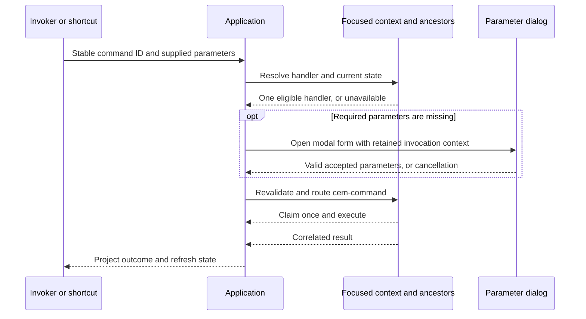

# Application orchestration

**Status:** design proposal, 2026-11-23. This document proposes
`cem-application`; it does not introduce a shipped component, capability, or
binding syntax. Read it with [command.md](command.md) and
[localization.md](localization.md). Existing accepted interaction and lifecycle
contracts remain authoritative until an explicit implementation revision adopts
these additions.

## Purpose

`cem-application` coordinates resource-backed commands and localization for one
application region. A menu item, toolbar action, command palette entry, keyboard
shortcut, or native-shell menu invokes the same stable command ID. The
application resolves a contextual handler, collects missing arguments when
necessary, and records a correlated outcome. A locale change replaces resource
presentations without changing command identity or executing commands again.

This is a UI coordination boundary, distinct from the existing compiled
`cem-application-declaration/1` artifact. It is not a window manager, router,
permission grant, replacement data loader, or owner of every component's state.

## Ownership

| Owner | Responsibility |
| --- | --- |
| `cem-application` declaration in `cem-components` | Declarative composition, resource/context bindings and application status projection; no production JavaScript |
| Generic capabilities in `cem-elements` | Registry subscription, focused-context tracking, command routing, invocation correlation, shortcut matching, parameter-form coordination and teardown |
| Native CEM-ML/import/resource layers | Typed resource trees, resource references, schema validation, locale selection inputs, provenance and lifecycle revisions |
| Command handler component | Context-specific eligibility, execution and result; stable domain target identity |
| Native `dialog` through `cem-dialog` | Modality, form controls, validation, focus and surface lifecycle |
| Host service adapter | Clipboard, file picker, persistence, native shell notifications and other admitted non-UI services |
| Application data | Document contents, selection, dirty state, authorization and undo history |

Follow the [declarative UI principle](../../../docs/declarative-ui-principle.md):
missing generic capabilities must be added to `cem-elements` before component
UI work. The runtime must use generic provider contracts, without branching on
`cem-application` or editor tag names. App-owned scripts may implement non-UI
services; they must not manufacture visible UI, attach local keyboard handlers,
or implement a competing dialog controller.

## Proposed application surface

These names are design inputs, not current attributes. Structured inputs are
native CEM values/references, never JSON text hidden in an attribute.

| Input | Meaning |
| --- | --- |
| `resources` | Typed reference to an admitted application resource set containing semantic command definitions and locale manifests |
| `locale` | `auto` by default, or an explicit BCP 47 UI language tag; not an operating-system locale setter |
| `fallback-locale` | Application default language, required to exist in the resource manifest |
| `format-locale` | Optional separate date/number formatting preference; defaults to the resolved UI locale |
| `shortcut-profile` | Admitted platform profile; host-provided when available, otherwise an explicit web profile |
| `command-context` | Optional typed reference to the initial content context; otherwise learned from focus |
| Default slot | Application contents, retaining native landmarks and component ownership |

Derived state includes requested languages, effective UI locale, format locale,
direction, resource generation, shortcut generation, active content context,
and bounded invocation summaries. Publish it in the application's durable data
island through ordinary native resource/slice/event channels. It is queryable
state, not a second JavaScript document model or a new island topology.

`cem-application` does **not** automatically set `role="application"`. Keep
normal document navigation and native landmarks. An application name can label
an appropriate region without forcing assistive technologies into a special
keyboard mode.

## Application boundary and lifecycle

The nearest application owns an invocation. Nested applications have independent
registries, focus memories, locale preferences and shortcut maps. Outer
applications ignore inner key and command requests, even if an inner command is
unhandled. Sharing a resource tree does not share invocation authority. An
explicit bridge may forward an allowlisted command, with a fresh correlation
link and declared context; ancestry alone is not permission.

1. On connection, resolve and admit resource references under the existing CEM
   scopes/grants. Validate unique command IDs and a complete default locale.
2. Materialize the typed definitions and a coherent presentation generation.
   Until ready, resource-bound controls are unavailable and no shortcut is
   intercepted. Normal native links, controls and browser editing still work.
3. Register generic handler/context providers and subscribe to their state.
   Multiple instances of an editor may handle the same command ID.
4. Install one coordinated key dispatcher per application boundary through the
   shared runtime service. Do not add a listener per menu item.
5. On context, resource, permission or host-profile changes, invalidate only the
   affected eligibility/presentation snapshots. Unrelated renders do not reset
   focus or drafts.
6. On disconnection, release listeners, provider registrations, native value
   owners and observers; abort pending preparation and dialogs. Fence late
   results from publishing to a replacement application instance. An already
   committed host side effect cannot be rolled back merely by disconnecting.

Resource loading uses the
[common lifecycle](../../../docs/cem-ml-resource-lifecycle.md), including failed
and superseded revisions. No second loading state machine is introduced for
locale bundles. The
[durable data-island contract](../../../docs/cem-element-lifecycle-principle.md)
continues to own rendering, resume and native value retention.

## Focus and command context

Maintain separate **DOM focus**, **content command context**, **invoker**, and
**return-focus destination**. They are frequently different elements.

When an editor owns focus, it becomes the active content context. Before focus
enters command chrome, such as a toolbar, menu or command palette, capture that
context in the interaction session. Opening a parameter dialog retains the
same target and invocation ID. Focusing the dialog must not replace the pending
Save As target with the dialog's form or an unrelated editor.

A context-menu session captures the context under the pointer or keyboard
invocation, which may differ from the last focused editor. That explicit context
has priority for that session. An explicitly supplied `command-context` uses the
existing typed reference/placement validation; it is not a CSS selector. Add it
to the reference consumer only as part of the future implementation.

For an ordinary shortcut, use current content focus. For command chrome, use its
captured content origin. For an application-scoped command with no content
origin, the application itself is the route origin. A focused native text field
within a parameter dialog gets normal editing commands; only the already
pending invocation retains its earlier target. Background application commands
are blocked during a modal task unless explicitly classified as modal-safe.

Provider identity and domain context are retained, rather than a translated
label, list index, or arbitrary descendant of the generated DOM. Validate that
the target remains connected, admitted and bound to the same document before
execution. Target loss cancels the request; it never silently saves whichever
document later receives focus. Cross-document/iframe routing requires an
explicit host bridge; DOM bubbling cannot cross a browsing context.

## Invocation orchestration

The full state machine, event contract, duplicate prevention and parameter rules
are in [command.md](command.md). The application orchestrates; it does not execute
every command in a document-global handler. A local editor can own Copy, its
document owner Save As, and the application Preferences.

Closing menus and opening a modal task must cooperate with the existing menu
task relay and [surface lifecycle](dialog-contract.md). Do not synthesize a
second click or native `command` to carry out the same operation. An accepted
parameter form produces one final execution request, not an opening request
followed by a second unrelated invocation.

## Locale changes as a transaction

`locale="auto"` follows available browser or host language preferences. A native
adapter can report OS/application language changes; the browser exposes its own
language preferences and `languagechange`. A web application cannot promise to
observe every OS setting change immediately. Explicit app preferences take
precedence. See [HTML language preferences](https://html.spec.whatwg.org/multipage/system-state.html#language-preferences).

Prepare a new resource generation off the active projection, including strings,
direction, mnemonics, platform shortcuts and accessibility strings. Validate it,
then publish it as one application state revision. CEM render scheduling may
update several DOM owners, but input dispatch must never use bindings from a
different active generation than the presented controls. Use a brief dispatch
barrier until affected projections acknowledge the revision; do not claim the
browser performs an atomic multi-node DOM mutation.

Failed or superseded preparation leaves the previous coherent generation
active. The first load needs a valid packaged default before commands become
available. Open forms keep their edited values, selection, native owner identity
and pending invocation. Relocalize labels and validation messages without
reopening the task or clearing user input. Resolve a new mnemonic map; retain
the dialog's entry and return-focus relationships.

Presentation may change while an invocation waits. Its semantic command/schema
revision remains pinned. If that semantic revision changes, revalidate or
cancel the pending invocation instead of interpreting old input under a new
schema. Locale changes alone neither cancel execution nor replay a result.

## Host adapters and activation

Keep native menus and browser menus on the same command registry and state-query
contract. A host-origin request carries an admitted application/context identity
and a correlation ID; it must not broadcast into every application in a window.
Host menu updates subscribe to the published locale and eligibility revisions.

The existing `host-command` bridge is a narrower scalar service boundary, not
this proposed routing protocol. Extend it explicitly or add a separately named
adapter for typed parameters; preserve its nested-view and ownership checks.
DOM event `isTrusted` is not an authorization token. A runtime-generated
`cem-command` is synthetic even when a genuine user gesture caused it.

Preserve existing host checkpoint effect accounting in opted-in domains: begin
the admitted operation before a side effect, acknowledge its actual outcome,
and retain unknown outcomes on disconnect/failure. A command invocation ID
correlates UI requests; it does not replace the host operation journal or make
an unacknowledged effect safe to repeat.

Activation-gated operations must reach the permitted host API synchronously
from the originating click/key event, or from the final dialog submit gesture.
Do not await bundle loading, a worker round trip or eligibility computation and
assume transient activation survives. Preload eligibility and schemas; the
browser/host still decides permission. A free-form file path cannot grant write
access: web Save As normally asks a picker for a file capability or offers a
download fallback. Cancellation remains distinct from an execution error.

## Missing capabilities and implementation order

This proposal requires new shared capabilities; none are delivered here.

1. Define native command/resource vocabularies and schema revisions; implement
   locale selection, typed parameter validation and cross-format import tests.
2. Add application/context/provider registrations and deterministic eligibility
   queries, including nested boundaries and explicit reference admission.
3. Add one-claim execution routing, native event/slice capture, correlation and
   lifecycle fences. Connect admitted non-UI host service adapters.
4. Add parameter-form sessions using existing dialog/form capabilities. Verify
   final-submit activation and file-capability handling.
5. Add shortcut profiles, customization/conflict diagnostics and coherent locale
   generation publication, including native menu adapters.
6. Only then add the declarative `cem-application` component and resource binding
   to actions/menu items, with colocated stories and property/gallery coverage.

Do not add per-component scripts to bypass a missing stage. Existing native
invoker behavior must remain independently usable throughout migration.

## Acceptance and limits

Future implementation acceptance requires:

- Two editors handling the same ID route by content context, including toolbar,
  menu, pointer context menu, keyboard and native-shell invocation.
- An unhandled inner-application command never executes in the outer app;
  disposal/rebinding prevents late execution and publication.
- Cancel, invalid submit, rejected close and target removal produce no operation;
  accepted submit executes once, even under rapid activation.
- Locale switch during an open menu, edited form, pending command and slow bundle
  load preserves owner identity and rejects stale publication.
- Native Copy/Paste and form interaction remain available; shortcut/IME tests
  run on different keyboard layouts. Browser, native-shell and spoken AT
  verification are separate evidence.
- Inherited theme tokens, RTL, long labels, narrow viewports, keyboard focus and
  forced colors remain usable. Localization must not introduce component-local
  theme defaults or change the canonical token dimensions.
- SSR can render resolved resources; hydration subscribes to the same semantic
  revisions without replaying invocations. Persist locale and user keybindings;
  never auto-resume a command with side effects from saved event state.

This design leaves an OS adapter implementation, binary catalog codec selection,
cross-process command transport and durable undo transaction engine as separate
work. Those features must meet this boundary before claiming interoperability.
